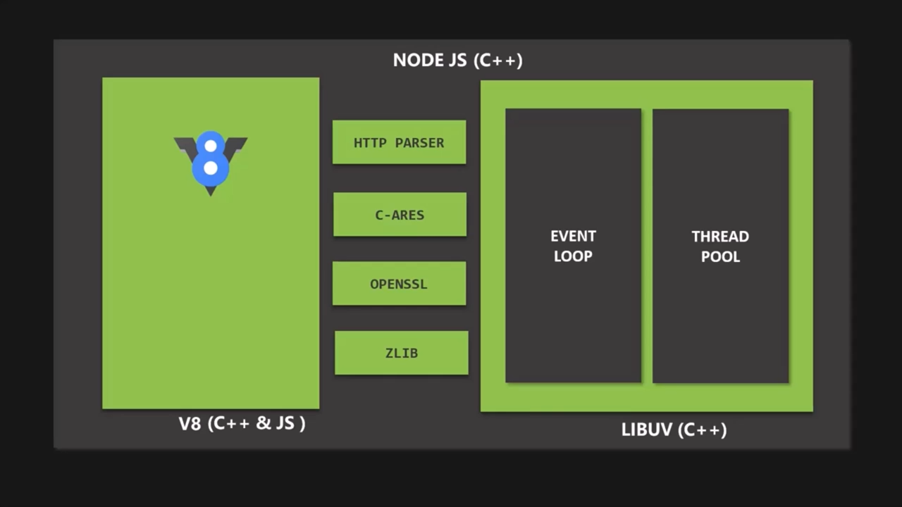
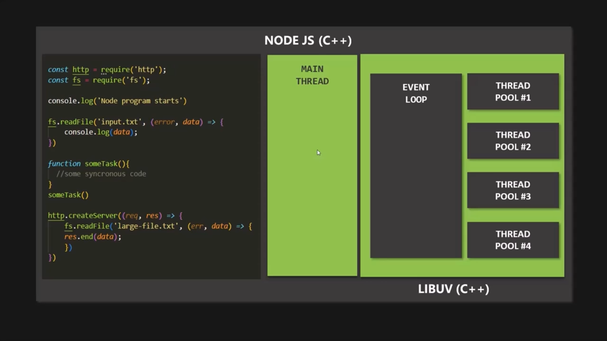
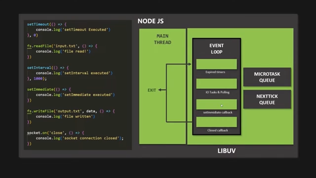
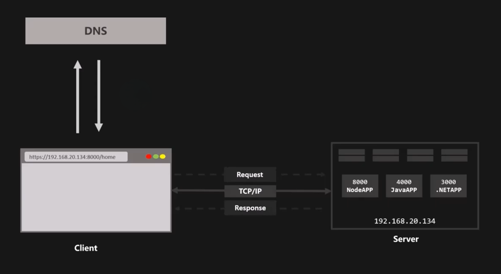
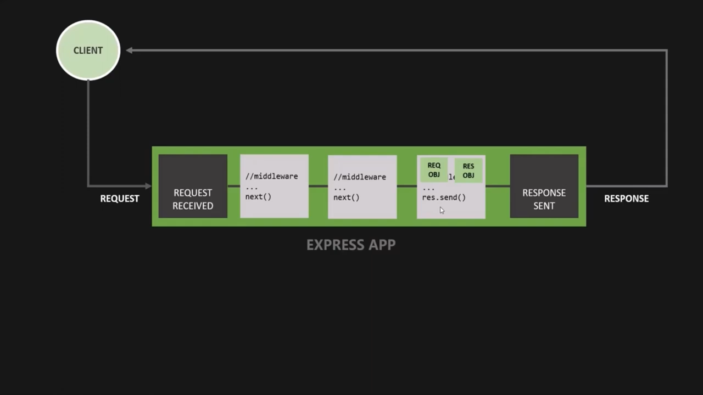
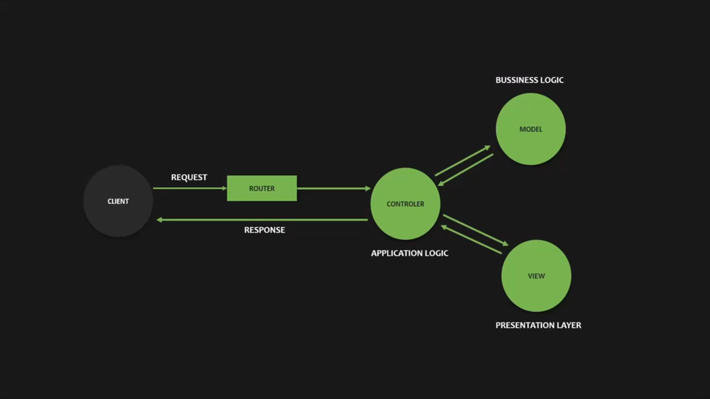

## **Node.js Architecture**
- **Core Dependencies :**
    - V8 JavaScript Engine (C++ & JavaScript) :
        * Converts JavaScript code into machine code.
    - libuv (C++) :
        * Open-source library.
        * Focused on handling asynchronous code.

**Note :**
* V8 by itself cannot create server-side applications because it does not provide access to:
    * File system.
    * Operating system.
    * Network.

<center>

</center>

- **What libuv Implements :**
    - **Event Loop :** 
        - Task orchestrator & a callback queue.
    - **Thread Pool :**
        * Handles heavy tasks such as: File access, Compression, Timers etc.
        * Default size: **4 threads**
        * Can be configured up to **1024 threads**
        * This threads are provided by libuv, they are not part of node.js process (single main thread).

<center>

</center>

### **Execution Order in Node.js**
- All top-level code (synchronous code) is executed first on the **main thread**.
- All asynchronous code is delegated to **libuv**.
- Heavy tasks are moved to the **thread pool** for execution.
- Callbacks are pushed into the **event loop callback queues**, waiting for execution.
- When the main thread becomes empty, the event loop starts pushing callbacks back to the main thread for execution.
- If a callback contains heavy work, it is again moved to the thread pool to avoid blocking the main thread.

### **Event Loop**
- The event loop has 4 phases, and each phase has its own callback queue:
    * **Phase 1:** Timers
        * Executes callbacks attached to: `setTimeout()`, `setInterval()`
    * **Phase 2:** I/O & Polling
        * Handles I/O tasks (networking and file access).
    * **Phase 3:** setImmediate Callbacks
        * Executes callbacks attached to `setImmediate()`.
    * **Phase 4:** Close Callbacks
        * Executes close event callbacks.


**Note :**
- If a phase receives a new callback while it is not currently being processed, that callback waits until the event loop cycles back to that phase (Phases execute one by one in order).

<center>

</center>

**Additional Callback Queues**
- There are are **not part of the event loop phases**:
    - **Microtask Queue :** Contains callbacks attached to Promise results.
    - **NextTick Queue :** Contains callbacks attached to `process.nextTick()`.
- These queues are processed **right after the current phase finishes**.

* Additional Event Loop Concepts
    * Each cycle of the event loop is called a **tick**.
    * If there are no timers or I/O tasks running, Node.js exits the application.

### **How to Avoid Blocking the Main Thread**
* Do not use synchronous versions of functions (`fs`, `crypto`, `zlib`) inside callbacks.
* Do not perform very complex calculations inside callback functions (handling large JSON objects).
* Do not use overly complex regular expressions inside callback functions.

## **Client/Server Architecture** 

### **Roles of HTTP, TCP, and IP in Web Communication**

**Hypertext Transfer Protocol (HTTP)**

* Defines the structure of requests and responses.   
    - Start line -> Headers -> (empty line) -> Body
* Specifies headers, methods, and status codes.
* Operates as a stateless protocol (does not retain information about previous requests).

**Transmission Control Protocol (TCP)**

* Establishes the connection using a three-way handshake.
* Ensures reliable data delivery by splitting data into packets and reassembling them correctly.
* Manages connection termination (close or keep-alive a connection).

**Internet Protocol (IP)**
* Routes packets across networks from the source to the destination.


### **How a Web Request Works?**

* **Step 01:** The domain name is resolved to its corresponding IP address through DNS.
* **Step 02:** TCP/IP (both protocols set the rules how data moves accross the internet) socket connection  are established between server and browser. This connection will kept alive for the entire time it to send a requests and resive a responses with all files of the website.
* **Step 03:** Once the connection is ready, the browser sends the HTTP request to the server.

<center>

</center>

- **Note :** Developers control HTTP headers & status codes in server responses, while browsers handle request headers. If developers don’t set the correct status code, the server may return 200 OK by default—even when it should return 404 Not Found.

## **Create a server**


```python
// - Create a server using http module.
const http = require('http');

// # Step 1: Create a server.
// - createServer : it is a node api that returns a server object.
const server = http.createServer((req, res) => {
    // - the callback function will be executed every time a request is made to the server.
    // - req : request object (contain all the information about the incoming request).
    // - res : response object (used to send response back to the client).

    console.log("Request received: " + req.url);
    // Result:
    // Request received: /
    // Request received: /favicon.ico
    res.end("Hello World");
    // - if we miss to send the response, the client will keep waiting
    // for the response and the connection will remain open until it times out.
    // - end method : accept a string as an argument and send it as a response to the client.
})
// # Step 2: Start the server and listen on a specific port
server.listen(3000,'localhost', () => {
    // - the callback function will be executed once the server starts successfully
    //  and it is optional.
    console.log("Server is listening on port 3000");
});
```

## **Event-Driven Architecture**

* **Event Emitter:** Emits (sends) a named event.
* **Event Listener:** Waits for a specific event and triggers the corresponding handler.
* **Event Handler:** A callback function executed when the event listener detects the event.


```python
// EMITTING & HANDLING CUSTOM EVENTS
// - handle events using the EventEmitter class from the 'events' module.
const EventEmitter = require('events');
class user extends EventEmitter {}

let myEmitter = new user();

myEmitter.on('userCreated', (id, name) => {
    console.log(`A new user ${name} with ID ${id} is created!`)
})

// - on : it is a method used to attach a listener to an event.
myEmitter.on('userCreated', (id, name) => {
    console.log(`A new user ${name} with ID ${id} is added to database!`)
})

// - emit : it is a method used to trigger an event and execute
//  all the listeners attached to that event.
myEmitter.emit('userCreated', 101, 'John');
// # Result:
// A new user John with ID 101 is created!
// A new user John with ID 101 is added to database!
```

### **Copled VS Decopled logic**

- **Copled logic**
    - The server can emit & listen to the event as it an instance of EventEmitter class

<center>

</center>


```python
const http = require('http');

const server = http.createServer((req, res) => {
    console.log("Request received: " + req.url);
    res.end("Hello World");
})

server.listen(3000,'localhost', () => {
    console.log("Server is listening on port 3000");
});
```

- **Decopled logic**
    - Can react to an event multiple times using multipe listeners.

<center>

</center>


```python
const http = require('http');

// Event Emitter (the name of the event is 'request')
const server = http.createServer();

// Event Listener for 'request' event
server.on('request', (req, res) => {
    res.end('Hello from the server!');
})

server.listen(8000, '127.0.0.1', () => {
    console.log('listening to requests...')
})
```

## **Buffered I/O**
- Loading the Entire File at Once

<center>

</center>

### **Read/write synchronously**


```python
// # Return a file system object 
const fs = require('fs');

// # Reading  a file synchronusly :
// - Read from input.txt file using utf-8 encoding
// - readFileSync : it is a node api
// - read file Synchronusly 
let textIn = fs.readFileSync('./Files/input.txt', 'utf-8');
console.log(textIn);

// # Writing into a file synchronusly :
let content = `Data read from input.txt: ${textIn}. \nDate created ${new Date()}`;
// - Write to output.txt file
// - if file not exist nodeJS will create it then write into it.
fs.writeFileSync('./Files/output.txt', content);
```

### **Read/write Asynchronously**

* If we write **synchronous code** on the server, user requests are handled one at a time, making others wait.
* **Asynchronous code** prevents this single-thread bottleneck, allowing multiple operations to proceed without blocking.
* In **PHP**, each user request typically gets a separate thread.
* With asynchronous code, operations at the same level may execute in an unexpected order, which is why **nesting** is often needed.

**Note:** Every asynchronous API usually uses a callback function, but the presence of a callback does **not** guarantee that the code is truly asynchronous.


```python
const fs = require('fs');

// # Read a file Asynchronusly :
// - it execution will be in the background once it complete
// the callback function will move to the main thread to be executed.
fs.readFile('./Files/input.txt', 'utf-8', (err,data) => {
    // - data : the content of the file
    // - err : if there is an error while reading the file it will be stored in this variable
    if(err) {
        console.log("Error reading file: ", err);
        return;
    }
    console.log("File content:", data);
});

// # Write a file Asynchronusly :
fs.writeFile('./Files/output.txt', 'Hello World!', (err) => {
    if(err) {
        console.log("Error writing file: ", err);
        return;
    }
    console.log("File written successfully!");
});
```

## **Streamed I/O** 
- Processing Data in Chunks.

<center>

</center>

- **Note :** Streams in Node.js are asynchronous by nature, because they emit events.

### **Readable stream**
- Used to read or consume data by chunks ex: Request stream, Read file stream...etc.
- **Readable stream events :**
    - **data event :** it is emitted when new chunck is ready to use.
    - **end event :** it is emitted when there is no data to consume.

- **Read file stream**


```python
const fs = require('fs');

// Create a readable stream
let rs = fs.createReadStream('./Files/large-file.txt');

// Listen for 'data' event
rs.on('data', (chunk) => {
    console.log(chunk.toString());
});

// Listen for 'end' event
rs.on('end', () => {
    console.log("File reading completed.");
});
```

- **Request stream**


```python
const http = require('http');

const server = http.createServer((req, res) => {
    if (req.method === 'POST') {
        let body = '';

        // 'data' event emits chunks of the request body
        req.on('data', (chunk) => {
            console.log('Received chunk:', chunk.toString());
            body += chunk;
        });

        // 'end' event signals that all chunks have been received
        req.on('end', () => {
            console.log('Request fully received:', body);
            res.writeHead(200, { 'Content-Type': 'text/plain' });
            res.end('Data received successfully!');
        });

        req.on('error', (err) => {
            console.error('Error reading request:', err);
            res.writeHead(500);
            res.end('Server error');
        });
    } else {
        res.writeHead(200, { 'Content-Type': 'text/plain' });
        res.end('Send a POST request to test streaming.');
    }
});

server.listen(3000, () => {
    console.log('Server listening on port 3000');
});
```

### **Writable Stream**

* Used to **write or send data in chunks** Ex : writing to a file, sending an HTTP response...etc.

* **Writable stream events:**

  * **drain event:** Emitted when the internal buffer is emptied and it’s safe to write more data.
  * **finish event:** Emitted when all data has been flushed to the destination.

* **Write file stream**


```python
const fs = require('fs');

// Create a writable stream
let ws = fs.createWriteStream('./Files/output.txt');

// Write data in chunks
ws.write('Hello, ');
ws.write('this is streamed ');
ws.write('to a file.\n');

// Signal that writing is complete
ws.end('All data written.\n');

// Listen for finish event
ws.on('finish', () => {
    console.log('File writing completed.');
});

// Listen for errors
ws.on('error', (err) => {
    console.error('Error writing file:', err);
});
```

* **Response (HTTP) stream**


```python
const http = require('http');

const server = http.createServer((req, res) => {
    res.writeHead(200, { 'Content-Type': 'text/plain' });

    // Write data in chunks
    res.write('Hello, ');
    res.write('this is a streamed ');
    res.write('HTTP response.\n');

    // End the response
    res.end('All data sent.\n');

    // Optional: listen for finish event
    res.on('finish', () => {
        console.log('Response fully sent to client.');
    });
});

server.listen(3000, () => {
    console.log('Server listening on port 3000');
});
```

### **Stream Backpressure Problem**

* **Backpressure:**
  Occurs when a **readable stream** produces data faster than a **writable stream** can consume it.

- **Solution 1: Without Streams (Full Buffer Loading)**
    - For large files, this consumes a lot of memory and may crash the server.


```python
server.on('request', (req, res) => {
    fs.readFile('./Files/large-file.txt', (err, data) => {
        if (err) {
            res.end('Something went wrong!');
            return;
        }
        res.end(data);
    });
});
```

- **Solution 2: Using Readable & Writable Streams (Manual Handling)**
    - if the readable stream is faster than the writable stream, **backpressure can still occur**.


```python
server.on('request', (req, res) => {
    let rs = fs.createReadStream('./Files/large-file.txt');

    rs.on('data', (chunk) => {
        res.write(chunk);
    });

    rs.on('end', () => {
        res.end();
    });

    rs.on('error', (error) => {
        res.end(error.message);
    });
});
```

- **Solution 3: Using `pipe()` (Recommended)**
    - `pipe()` Connects streams together, allowing data to flow automatically from a readable stream to a writable stream in chunks.

    - It pauses the readable stream when the writable stream buffer is full and resumes when it is ready.


```python
server.on('request', (req, res) => {
    let rs = fs.createReadStream('./Files/large-file.txt');
    rs.pipe(res);
});
```

## **Routing**
- **Routing :** determines how application endpoints handle client requests. It allows the server to return different responses for different URLs.

- **Types of URLs :**
    - File base URL :
        - looking for the physical file on the server.
        ```code
        Protocol://IP:Port/file.extension
        ```
    - Resourse base URL :  
        - will be handeled using the server handler.
        ```code
        Protocol://IP:Port/Resource/Route_Param1/Route_Param2?Query_param1=value&Query_param2=value
        ```


```python
// Import the http module
const http = require('http');

// STEP 1: CREATE A SERVER
const server = http.createServer((request, response) => {
    let path = request.url;

    if(path === '/' || path.toLocaleLowerCase() === '/home'){
        response.statusCode = 200;
        response.setHeader('Content-Type', 'text/html');
        response.setHeader('custom-header', 'custom-value');
        response.end('You are in home page');
    } else if(path.toLocaleLowerCase() === '/about'){
        response.writeHead(200, {
            'Content-Type': 'text/html', 
            'custom-header': 'custom-value'
        });
        response.end('You are in about page');
    } else if(path.toLocaleLowerCase() === '/contact'){
        response.write('You are in contact page');
        response.write('This is the second line of the response');
        response.end();
    } else {
        response.end('Error 404: Page not found!');
    }
});

// STEP 2: START THE SERVER
server.listen(8000, '127.0.0.1', () => {
    console.log('Server has started!');
});
```

### **Practical example (phone store)**

- **file : ./Modules/replaceHtml.js**


```python
// The `module` object is a global object in Node.js
// It is used to export functionality from one file to another.

module.exports = function (template, product) {

    let output = template;

    // Replace template placeholders with product data
    output = output.replace('{}',     product.productImage);
    output = output.replace('{}',      product.name);
    output = output.replace('{}', product.modeName);
    output = output.replace('{}',   product.modelNumber);
    output = output.replace('{}',      product.size);
    output = output.replace('{}',    product.camera);
    output = output.replace('{}',     product.price);
    output = output.replace('{}',     product.color);
    output = output.replace('{}',        product.id);
    output = output.replace('{}',       product.ROM);
    output = output.replace('{}',      product.Description);

    return output;
};
```

- **file : ./app.js**


```python
// ===============================
// CORE MODULES
// ===============================
const fs   = require('fs');
const http = require('http');
const url  = require('url');


// ===============================
// USER-DEFINED MODULES
// ===============================
const replaceHtml = require('./Modules/replaceHtml');


// ===============================
// LOAD FILES (Synchronous)
// ===============================
const htmlTemplate        = fs.readFileSync('./Template/index.html', 'utf-8');
const productsData        = fs.readFileSync('./Data/products.json', 'utf-8');
const productListTemplate = fs.readFileSync('./Template/product-list.html', 'utf-8');
const productDetailTemplate = fs.readFileSync('./Template/product-details.html', 'utf-8');

const products = JSON.parse(productsData);


// ===============================
// CREATE SERVER
// ===============================
const server = http.createServer((request, response) => {

    // Parse URL
    const { query, pathname } = url.parse(request.url, true);
    const path = pathname.toLowerCase();

    // ===========================
    // ROUTING
    // ===========================

    // -------- HOME --------
    if (path === '/' || path === '/home') {

        response.writeHead(200, {
            'Content-Type': 'text/html',
            'my-header': 'Hellow, world'
        });

        response.end(
            htmlTemplate.replace('{}', 'You are in Home page')
        );
    }

    // -------- ABOUT --------
    else if (path === '/about') {

        response.writeHead(200, {
            'Content-Type': 'text/html',
            'my-header': 'Hellow, world'
        });

        response.end(
            htmlTemplate.replace('{}', 'You are in About page')
        );
    }

    // -------- CONTACT --------
    else if (path === '/contact') {

        response.writeHead(200, {
            'Content-Type': 'text/html',
            'my-header': 'Hellow, world'
        });

        response.end(
            htmlTemplate.replace('{}', 'You are in Contact page')
        );
    }

    // -------- PRODUCTS --------
    else if (path === '/products') {

        // ----- Product List -----
        if (!query.id) {

            const productHtmlArray = products.map((product) => {
                return replaceHtml(productListTemplate, product);
            });

            const productResponseHtml = htmlTemplate.replace(
                '{}',
                productHtmlArray.join(',')
            );

            response.writeHead(200, { 'Content-Type': 'text/html' });
            response.end(productResponseHtml);
        }

        // ----- Product Details -----
        else {

            const product = products[query.id];

            const productDetailHtml = replaceHtml(
                productDetailTemplate,
                product
            );

            response.end(
                htmlTemplate.replace('{}', productDetailHtml)
            );
        }
    }

    // -------- 404 --------
    else {

        response.writeHead(404, {
            'Content-Type': 'text/html',
            'my-header': 'Hellow, world'
        });

        response.end(
            htmlTemplate.replace(
                '{}',
                'Error 404: Page not found!'
            )
        );
    }
});

// ===============================
// START SERVER
// ===============================
server.listen(8000, '127.0.0.1', () => {
    console.log('Server has started!');
});
```

## **Node Package Manager (NPM)**

* NPM provides:
    * **Command Line Interface (CLI)** → Used to install, manage, and update packages.
    * **Package Repository** → A large open-source registry of reusable packages.

* **Types of Dependencies**

| Dependency Type              | Description                                                                                                                             |
| ---------------------------- | --------------------------------------------------------------------------------------------------------------------------------------- |
| **Regular Dependencies**     | Required for the application to run. The application depends on these packages in production.                                           |
| **Development Dependencies** | Required only during development (testing, debugging, auto-restart tools, etc.). The application does not depend on them in production. |

* **Types of Package Installation**

| Installation Type  | Description                                                                                                           |
| ------------------ | --------------------------------------------------------------------------------------------------------------------- |
| **Local Install**  | The package is available only inside the project folder where it is installed. It cannot be used outside that folder. |
| **Global Install** | The package is installed on the machine and can be accessed from any folder or project directory. 

### **Important NPM Commands**

```bash
npm init
```

* Initializes a new Node.js project.
* Creates a `package.json` file.
* Prompts for:
  * Project name
  * Version
  * Description
  * Entry point
  * Test command
  * Repository
  * Keywords
  * Author
  * License
* You can press **Enter** to accept default values.

```bash
npm install express@version
```

* Installs the Express framework.
* Creates a `node_modules` folder in your project.
* Adds Express to `package.json` under **dependencies**.
* Downloads Express and its required sub-packages.

```bash
npm install nodemon --save-dev
```

* Installs **nodemon** locally.
* Adds it under **devDependencies** in `package.json`.
* Used during development to automatically restart the server when files change.

```bash
npm install -g nodemon
```

* `-g` installs nodemon globally on your machine.
* Makes it available from any project directory.

## **ExpressJS**

### **CRUD on a Local JSON file**


```python
// IMPORT PACKAGES
const express = require('express');
const fs = require('fs');

let app = express();
let movies = JSON.parse(fs.readFileSync('./data/movies.json'));

// Middleware to parse JSON bodies
app.use(express.json());

// app.set() configures an Express application setting.
// "query parser" specifies which setting to configure.
// "extended" tells Express to parse nested query parameters using extended parsing.
// example : http://localhost:3000/movies?createdAt[lte]=2019
// req.query = { createdAt: { $lte: 2019 } }
app.set("query parser", "extended");


// ROUTE HANDLERS (Controller functions)
const getAllMovies = (req, res) => {
    res.status(200).json({
        status: "success",
        count: movies.length,
        data: {
            movies: movies
        }
    });
};

const getMovie = (req, res) => {
    const id = parseInt(req.params.id);
    const movie = movies.find(el => el.id === id);
    
    if (!movie) {
        return res.status(404).json({
            status: "fail",
            message: "Movie not found"
        });
    }
    
    res.status(200).json({
        status: "success",
        data: {
            movie: movie
        }
    });
};

const createMovie = (req, res) => {
    const newId = movies[movies.length - 1].id + 1;
    const newMovie = Object.assign({ id: newId }, req.body);
    
    movies.push(newMovie);
    fs.writeFile('./data/movies.json', JSON.stringify(movies), err => {
        if (err) {
            return res.status(500).json({
                status: "error",
                message: "Failed to save movie"
            });
        }
        
        res.status(201).json({
            status: "success",
            data: {
                movie: newMovie
            }
        });
    });
};

const updateMovie = (req, res) => {
    const id = parseInt(req.params.id);
    const movieIndex = movies.findIndex(el => el.id === id);
    
    if (movieIndex === -1) {
        return res.status(404).json({
            status: "fail",
            message: "Movie not found"
        });
    }
    
    movies[movieIndex] = Object.assign({}, movies[movieIndex], req.body);
    
    fs.writeFile('./data/movies.json', JSON.stringify(movies), err => {
        if (err) {
            return res.status(500).json({
                status: "error",
                message: "Failed to update movie"
            });
        }
        
        res.status(200).json({
            status: "success",
            data: {
                movie: movies[movieIndex]
            }
        });
    });
};

const deleteMovie = (req, res) => {
    const id = parseInt(req.params.id);
    const movieIndex = movies.findIndex(el => el.id === id);
    
    if (movieIndex === -1) {
        return res.status(404).json({
            status: "fail",
            message: "Movie not found"
        });
    }
    
    movies.splice(movieIndex, 1);
    
    fs.writeFile('./data/movies.json', JSON.stringify(movies), err => {
        if (err) {
            return res.status(500).json({
                status: "error",
                message: "Failed to delete movie"
            });
        }
        
        res.status(204).json({
            status: "success",
            data: null
        });
    });
};

// ROUTES - Using app.route() for cleaner code organization
app.route('/api/v1/movies')
    .get(getAllMovies)
    .post(createMovie);

app.route('/api/v1/movies/:id')
    .get(getMovie)
    .patch(updateMovie)
    .delete(deleteMovie);

// CREATE A SERVER
const port = 3000;
app.listen(port, () => {
    console.log(`Server is running on port ${port}...`);
});
```

## **Middleware**

<center>

</center>

- The main role of middleware is to perform processing on the request (req) and response (res) objects. It can also be used to execute custom logic.
- Middleware Syntax :
    ```js
    app.use((req, res, next) => {
        // logic
    });
    ```
    * `req` → Incoming request object
    * `res` → Outgoing response object
    * `next` → Function used to pass control to the next middleware
- Route Handlers are Middlewares
- **Execution Order :** Middleware functions execute **in the same order they are defined** in the application.

### **Built-in middleware**
* **How Node.js Handles an HTTP Request :** When a request reaches Node.js, it:
    * Parses the **request line**
    * Parses the **headers**
    * Separates headers from the body
    * Leaves the **body as a raw stream**

**Note :** This happens because HTTP does **not define what the body contains**, so Node.js does not automatically parse it.

- **Example Without Body Parsing**


```python
const express = require('express');
const app = express();

app.post('/', (req, res) => {
    console.log('Request headers:', typeof req.headers);
    console.log('Request body:', typeof req.body);
    res.send('Hello World!');
});

app.listen(3000, () => {
  console.log('Server listening on port 3000!');
});

// Equivalent Behavior Using the `http` Module
const http = require('http');
const server = http.createServer();

server.on('request', (req, res) => {
    console.log('Request headers:', typeof req.headers);
    console.log('Request body:', typeof req.body);
    res.end('Hello World!');
});

server.listen(3000, '127.0.0.1', () => {
    console.log('Server listening on port 3000!');
});

// # Result:
// Server listening on port 3000!
// Request headers: object
// Request body: undefined
```

- **Example With Body Parsing**


```python
const express = require('express');

const app = express();

app.use(express.json());
// Reads the raw byte stream from the request
// Converts it to a string
// Runs JSON.parse() on it
// Stores the result inside: req.body

// equivalent to app.use(express.json())
app.use((req, res, next) => {
    let body = '';
    req.on('data', chunk => {
        body += chunk;
        console.log('chunk received: ', chunk);
    });

    req.on('end', () => {
        body = JSON.parse(body);
        console.log('body received: ', body);
        req.body = body;
        next();
    });


});

app.post('/', (req, res) => {
    console.log('Request body:', req.body);
    res.send('Hello World!');
});

app.listen(3000, () => {
  console.log('Server listening on port 3000!');
});

// result:
// Server listening on port 3000!
// chunk received:  <Buffer 7b 0a 20 20 22 75 73 65 72 
// 22 20 3a 20 22 68 68 68 22 2c 0a 20 20 22 70 61 73 
// 73 22 20 3a 20 31 32 33 34 0a 7d>
// body received:  { user: 'hhh', pass: 1234 }
// Request body: { user: 'hhh', pass: 1234 }
```

### **Custom middleware**


```python
const express = require('express');
let app = express();

const logger = function(req, res, next) {
    console.log('Custom middleware called');
    next();
};

app.use(logger);
app.use((req, res, next) => {
    req.requestedAt = new Date().toISOString();
    next();
});

app.get('/', (req, res) => {
    res.status(200).json({
        status: 'success',
        message: 'Welcome to the Movie API',
        requestedAt: req.requestedAt
    });
});

app.listen(3000, () => {
    console.log('Server is running on port 3000');
});
```

### **Third-party middleware**


```python
const express = require('express');
let app = express();

const morgan = require('morgan'); 
app.use(morgan('dev'));

app.get('/', (req, res) => {
    res.status(200).json({
        status: 'success',
        message: 'Welcome to the Movie API',
    });

});

app.listen(3000, () => {
    console.log('Server is running on port 3000');
});
```


```python
const express = require('express');
let app = express();
let movies = JSON.parse(fs.readFileSync('./data/movies.json'));

// Custom middleware
const logger = function(req, res, next) {
    console.log('Custom middleware called');
    next();
};

// Built-in middleware
app.use(express.json());
// Third-party middleware
app.use(morgan('dev'));
// Custom middleware
app.use(logger);

// Custom middleware to add request timestamp
app.use((req, res, next) => {
    req.requestedAt = new Date().toISOString();
    next();
});

// Route handlers
app.get('/', (req, res) => {
    res.status(200).json({
        status: 'success',
        message: 'Welcome to the Movie API',
        requestedAt: req.requestedAt
    });
});

app.listen(3000, () => {
    console.log('Server is running on port 3000');
});
```

### **Route Mounting**


```python
// Step 1 : configuring the routes using express.Router() :

// - express.Router() is a built-in function 
// that have properties (methodes & attributes) like an object.
// - it is used to create a modular router.
const moviesRouter = express.Router();

// Routes are attached to router
moviesRouter.route('/')
  .get(getAllMovies)
  .post(createMovie);

moviesRouter.route('/:id')
  .get(getMovie)
  .patch(updateMovie)
  .delete(deleteMovie);

// Step 2 : Mounting the router on the main application :
// apply a middleware to routes starting with /api/v1/movies
app.use('/api/v1/movies', moviesRouter);

// CREATE A SERVER
const port = 3000;
app.listen(port, () => {
  console.log('server has started...');
});
```

### **Project files refactoring**


```python
// ./Controllers/moviesController.js
exports.getAllMovies = (req, res) => {
    res.status(200).json({
        status: 'success',
        data: {
            movies
        }
    });
};

// ./Routes/moviesRoutes.js
const express = require('express');
const moviesController = require('../Controllers/moviesController');

const moviesRouter = express.Router();

moviesRouter.route('/')
  .get(moviesController.getAllMovies);

module.exports = moviesRouter;

// ./app.js
const express = require('express');
const moviesRouter = require('./Routes/moviesRoutes');

const app = express();

app.use('/api/v1/movies', moviesRouter);

module.exports = app;

// ./server.js
const app = require('./app');

const port = 3000;
app.listen(port, () => {
  console.log('server has started...');
});
```

### **Parameter middleware**


```python
// ./Routes/moviesRoutes.js
const express = require('express');
const moviesController = require('../Controllers/moviesController');
const router = express.Router();

// router.param() is a method used to define middleware that will be executed
// whenever a specific route parameter is present in the request URL.
// In this case, it will log the movie id whenever a route with :id parameter is accessed.
router.param('id', (req, res, next, val) => {
    console.log(`Movie id is: ${val}`);
    next();
});

router.route('/')
  .get(moviesController.getAllMovies)
  .post(moviesController.createMovie);

router.route('/:id')
  .get(moviesController.getMovie)
  .patch(moviesController.updateMovie)
  .delete(moviesController.deleteMovie);


module.exports = router;
```

### **Chaining middlewares**


```python
// ./Controllers/moviesController.js

exports.validateId = (req, res, next) => {
  if(!req.body.name || !req.body.releaseYear) {
    return res.status(400).json({
      status: 'fail',
      message: 'Missing name or releaseYear in request body'
    });
  }
  next();
  }

// rest of the controller functions (getMovie, updateMovie, deleteMovie) would go here...

// ./Routes/moviesRoutes.js
const express = require('express');
const moviesController = require('../Controllers/moviesController');
const router = express.Router();

router.route('/')
  .post(moviesController.validateId, moviesController.createMovie);

module.exports = router;
```

### **Serving static files**

- NodeJS don't serve direcly the static files by default, ex : 
`http://localhost:3000/template/demo.html`


```python
// ./app.js
const express = require('express');

// serve all files in the public directory as static files
app.use(express.static('./public'));
```

## **Environment variables**

- Environment variables is something related to nodeJS not to express and they change depend on the envirenment where application is running (devlopment, test, production...etc)


```python
// - Log an object containing all environment variables set by nodeJS.
// - These variables are set the moment start nodeJS process.
// - process module is a global object is not necessary to import it to use it.
console.log(process.env);
```

- we can set env var using command line however it is not practical to set them each time you start the application so you need to set them in a configuration file.


```python
// Step 1 : Create a config.env file
// they will be added to process.env object when running the nodeJS process.
NODE_ENV=development;
PORT=3000;
DB_USERUSERNAME=admin;
DB_PASSWORD=1234;

// Step 2 : Load environment variables from config.env file
// npm install dotenv

// ./serever.js
const dotenv = require('dotenv');
dotenv.config({ path: './config.env' });

// - app must be imported after loading environment variables
const app = require('./app');

const port = process.env.PORT || 3000;
app.listen(port, () => {
    console.log(`Server is running on port ${port}...`);
});
```

## **Use Monodb with express**

### **Connect to database**


```python
// Step 1 : install mongodb driver which allows us 
// to intercat with mongoDB database using nodeJS.
// npm install mongoose

// Step 2 : connect our app to mongodb database

// ./server.js
const mongoose = require('mongoose');
mongoose.connect(process.env.DATABASE, {
    useNewUrlParser: true,
    useCreateIndex: true,
    useFindAndModify: false,
    useUnifiedTopology: true
}).then((conn) => {
    console.log(conn);
    console.log('Database connection successful!');
});

// ./config.env
DATABASE='mongodb://localhost:27017/db_name';
```

### **Define a shcema and use it**


```python
// ./server.js
const mongoose = require('mongoose');

// Step 1 : Connect to MongoDB
mongoose.connect('mongodb://127.0.0.1:27017/movieDB')
  .then(() => console.log('Connected to MongoDB'))
  .catch(err => console.error('Could not connect to MongoDB', err));

// Step 2 : Define the movie schema
// - A schema is a blueprint for the structure of the documents in a MongoDB collection.
// - It defines :
//    - The fields
//    - Their data types
//    - Some constraints on the data.
const movieSchema = new mongoose.Schema({
  name: {
    type: String,
    required: [true, 'Name is required field!'],
    unique: true
  },
  description: String,
  duration: {
    type: Number,
    required: [true, 'Duration is required field!']
  },
  ratings: {
    type: Number,
    default: 1.0
  }
});

// Step 3 : Create the Movie model
const Movie = mongoose.model('Movies', movieSchema);

// Step 4 : Create and save a new movie document
const movie = new Movie({
      name: 'Inception',
      description: 'A mind-bending thriller',
      duration: 148,
      ratings: 4.8
    });

movie.save().then((doc) => {
  console.log(doc);
})
.catch((err) => {
  console.log("error occur: ",err.message)
});
```

### **MVC architecture**

<center>

</center>


```python
// ./Models/movieModel.js
const mongoose = require('mongoose');

const movieSchema = new mongoose.Schema({
  name: {
    type: String,
    required: [true, 'Name is required field!'],
    unique: true
  },
  description: String,
  duration: {
    type: Number,
    required: [true, 'Duration is required field!']
  },
  ratings: {
    type: Number,
    default: 1.0
  }
});

const Movie = mongoose.model('Movies', movieSchema);
exports.Movie = Movie;
```


```python
// ./Controllers/moviesController.js
const { Movie } = require('../Models/movieModel');

exports.createMovie = async (req, res) => {
  try {
    const movie = await Movie.create(req.body);
    res.status(201).json({
      status: 'success',
      data: {
        movie
      }
    });
  } catch (err) {
    res.status(400).json({
      status: 'fail',
      message: err
    });
  }
};

// request example : 
// http://localhost:3000/movies?
// createdAt[lte]=2026
// sort=-ratings,price&
// fields=name,description,ratings,createdAt&
// limit=5&
// page=2&

// req.params = {}
// req.query = {
//   createdAt: { lte: '2026' },
//   sort: '-ratings,price',
//   fields: 'name,description,ratings,price',
//   limit: '5',
//   page: '2'
// }

// explanations :
// createdAt[lte]=2026 : filter movies created before 2026
// sort=-ratings,price : sort movies by ratings in descending order and price in ascending order
// fields=name,description,ratings,price : only return these fields
// limit=5 : limit the number of results to 5
// page=2 : return the second page of results

// response :
// {
  // "status": "success",
  // "results": 5,
  // "data": {
    // "movies": [
      // {
        // "name": "Inception",
        // "description": "A mind-bending thriller",
        // "ratings": 4.9,
        // "price": 10
      // },
      // {
        // "name": "The Shawshank Redemption",
        // "description": "A story of two imprisoned men",
        // "ratings": 4.8,
        // "price": 20
      // },
      // {
        // "name": "The Godfather",
        // "description": "A crime thriller",
        // "ratings": 4.7,
        // "price": 30
      // },
      // {
        // "name": "The Dark Knight",
        // "description": "A superhero thriller",
        // "ratings": 4.6,
        // "price": 40
      // },
      // {
        // "name": "Pulp Fiction",
        // "description": "A crime thriller",
        // "ratings": 4.5,
        // "price": 50
      // }
  // }
// }
exports.getAllMovies = async (req, res) => {
    try {
        // 1. BUILD QUERY USING APIFEATURES CLASS
        const features = new APIFeatures(Movie.find(), req.query)
            .filter()
            .sort()
            .limitFields()
            .paginate();
        
        // 2. EXECUTE QUERY
        const movies = await features.query;
        
        // 3. OPTIONAL: CHECK IF PAGE EXISTS
        if (req.query.page) {
            const pageExists = await features.checkPageExists();
            if (!pageExists) {
                return res.status(404).json({
                    status: 'fail',
                    message: 'This page does not exist'
                });
            }
        }
        
        // 4. SEND RESPONSE
        res.status(200).json({
            status: 'success',
            results: movies.length,
            data: {
                movies
            }
        });
    } catch (error) {
        res.status(404).json({
            status: 'fail',
            message: error.message
        });
    }
};

// request example : http://localhost:3000/movies/5
// req.params = { id: '5' }
// response :
// {
  // "status": "success",
  // "data": {
    // "movie": {
      // "_id": "5",
      // "name": "Inception",
      // "description": "A mind-bending thriller",
      // "author": "John Doe",
      // "duration": 148,
      // "ratings": 4.8,
      // "price": 10,
      // "createdAt": "2022-01-01T00:00:00.000Z"
      // "__v": 0,
      // }
  // }
// }

exports.getMovie = async (req, res) => {
  try {
    // const movies = await Movie.find({ _id: req.params.id });
    const movie = await Movie.findById(req.params.id);
    res.status(200).json({
      status: 'success',
      data: {
        movie
      }
    });
  } catch (err) {
    res.status(404).json({
      status: 'fail',
      message: err
    });
  }
};


// request example : http://localhost:3000/movies/5
// req.params = { id: '5' }
// req.body = { 
      // name: 'Inception', 
      // description: 'A mind-bending thriller', 
      // author: 'John Doe', 
      // duration: 148, 
      // ratings: 4.8, 
      // price: 10 
  // }

// response :
// {
  // "status": "success",
  // "data": {
    // "movie": {
      // "_id": "5",
      // "name": "Inception",
      // "description": "A mind-bending thriller",
      // "author": "John Doe",
      // "duration": 148,
      // "ratings": 4.8,
      // "price": 10,
      // "createdAt": "2022-01-01T00:00:00.000Z"
      // "__v": 0,
      // }
  // }
// }
// }
exports.updateMovie = async (req, res) => {
  try {
    const movie = await Movie.findByIdAndUpdate(req.params.id, req.body, {
      new: true, 
      // inorder to return the updated document
      runValidators: true 
      // inorder to validate the updated document against the schema validators
    });
    res.status(200).json({
      status: 'success',
      data: {
        movie
      }
    });
  } catch (err) {
    res.status(404).json({
      status: 'fail',
      message: err
    });
  }
};

exports.deleteMovie = async (req, res) => {
  try {
    await Movie.findByIdAndDelete(req.params.id);
    res.status(204).json({
      status: 'success',
      data: null
    });
  } catch (err) {
    res.status(404).json({
      status: 'fail',
      message: err
    });
  }
};

// ./Utils/apiFeatures.js - Reusable Class
class APIFeatures {
    constructor(query, queryString) {
        this.query = query;
        this.queryString = queryString;
    }

    filter() {
        // 1. FILTERING
        // Copy req.query
        const queryObj = { ...this.queryString };
        
        // Exclude special fields
        const excludedFields = ['page', 'sort', 'limit', 'fields'];
        excludedFields.forEach(field => delete queryObj[field]);
        
        // Advanced filtering with operators (gte, gt, lte, lt)
        let queryStr = JSON.stringify(queryObj);
        queryStr = queryStr.replace(/\b(gte|gt|lte|lt)\b/g, (match) => `$${match}`);
        
        const parsedQuery = JSON.parse(queryStr);
        
        // Store parsed query for later use (e.g., in pagination)
        this.parsedQuery = parsedQuery; 
        
        // Build query
        this.query = this.query.find(parsedQuery);
        
        return this;
    }

    sort() {
        // 3. SORTING
        if (this.queryString.sort) {
            // Convert comma-separated string to space-separated for mongoose
            const sortBy = this.queryString.sort.split(',').join(' ');
            console.log('Sorting by:', sortBy);
            
            // Apply sorting to query
            this.query = this.query.sort(sortBy);
        } else {
            // Default sort (optional)
            this.query = this.query.sort('name');
        }
        
        return this;
    }

    limitFields() {
        // 4. FIELD LIMITING
        if (this.queryString.fields) {
            // Select only specified fields
            const fields = this.queryString.fields.split(',').join(' ');
            console.log('Selecting fields:', fields);
            this.query = this.query.select(fields);
        } else {
            // Exclude __v field by default (Mongoose version key)
            this.query = this.query.select('-__v');
        }
        
        return this;
    }

    paginate() {
        // 5. PAGINATION
        const page = this.queryString.page * 1 || 1;  // Convert to number, default to 1
        const limit = this.queryString.limit * 1 || 10; // Convert to number, default to 10
        const skip = (page - 1) * limit;
        
        // Apply pagination
        this.query = this.query.skip(skip).limit(limit);
        
        // Store info for later use (e.g., to check if page exists)
        this.skip = skip;
        
        return this;
    }

    // Optional: Method to check if page exists
    async checkPageExists() {
        if (this.queryString.page) {
            // - The "model" property exists on Mongoose query objects 
            // to give you access back to the original Model.
            // - It's useful in scenarios where you've lost reference to the original model.
            // - In this case, you are allowed to don't use "model".
            const moviesCount = await this.query.model.countDocuments(this.parsedQuery);
            
            if (this.skip >= moviesCount) {
                return false;
            }
        }
        return true;
    }
}
```

- **Additional code used to empty and refill the database**


```python
// ./data/import-dev-data.js
const mongoose = require('mongoose');
const dotenv = require('dotenv');
const fs = require('fs');
const Movie = require('./../Models/movieModel');

dotenv.config({path: './config.env'});

//CONNECT TO MONGODB
mongoose.connect(process.env.CONN_STR, {
    useNewUrlParser: true
}).then((conn) => {
    console.log('DB Connection Successful');
}).catch((error) => {
    console.log('Some error has occured');
});

//READ MOVIES.JSON FILE
const movies = JSON.parse(fs.readFileSync('./data/movies.json', 'utf-8'));

//DELETE EXISTING MOVIE DOCUMENTS FROM COLLECTION
const deleteMovies = async () => {
    try{
        await Movie.deleteMany();
        console.log('Data successfully deleted!');
    }catch(err){
        console.log(err.message);
    }
    process.exit();
}

//IMPORT MOVIES DATA TO MONGODB COLLECTION
const importMovies = async () => {
    try{
        await Movie.create(movies);
        console.log('Data successfully imported!');
    }catch(err){
        console.log(err.message);
    }
    process.exit();
}

if(process.argv[2] === '--import'){ // node ./data/import-dev-data.js --import
    importMovies();
}
if(process.argv[2] === '--delete'){ // node ./data/import-dev-data.js --delete
    deleteMovies();
}
```

### **Aliasing a route**


```python
// ./Controllers/movieController.js
exports.getHighestRated = (req, res, next) => {
    req.query.limit = '5';
    req.query.sort = '-ratings';
    next();
}

exports.getAllMovies = async (req, res) => {
    try{
        const features = new ApiFeatures(Movie.find(), req.query)
                                .filter()
                                .sort()
                                .limitFields()
                                .paginate();
        let movies = await features.query;

        res.status(200).json({
            status: 'success',
            length: movies.length,
            data: {
                movies
            }
        });
    }catch(err){
        res.status(404).json({
            status: 'fail',
            message: err.message
        })
    }
}

// ./Routes/movieRoutes.js
import { getAllMovies, getHighestRated } from '../Controllers/movieController';

router.route('/').get(getAllMovies);
router.route('/highest-rated').get(getHighestRated, getAllMovies);
```

### **Agreggation pipline stages & operators**


```python
/**
 * Get movie statistics (average ratings, prices, etc.) grouped by release year
 * This function demonstrates MongoDB aggregation pipeline for data analysis
 */
exports.getMovieStats = async (req, res) => {
    try {
        // AGGREGATION PIPELINE - processes data in stages (like an assembly line)
        const stats = await Movie.aggregate([
            
            // STAGE 1: FILTER - Only include movies with ratings 4.5 or higher
            // Think of this as: "Give me only the good movies"
            { 
                $match: { ratings: { $gte: 4.5 } }  // $gte = "greater than or equal to"
            },
            
            // STAGE 2: GROUP - Organize movies by their release year
            // This is like putting movies into buckets based on their year
            { 
                $group: {
                    // _id defines what to group by - here we group by releaseYear
                    _id: '$releaseYear',  // The $ before field name means "use this field's value"
                    // you can use NULL if you don't want to group by anything
                    
                    // Calculate average rating for movies in each year
                    // Example: If 2020 has 3 movies with ratings 4.5, 4.8, 4.9, avgRating would be 4.73
                    avgRating: { $avg: '$ratings' },
                    
                    // Calculate average price for movies in each year
                    avgPrice: { $avg: '$price' },
                    
                    // Find cheapest movie price in each year
                    minPrice: { $min: '$price' },
                    
                    // Find most expensive movie price in each year
                    maxPrice: { $max: '$price' },
                    
                    // Calculate total revenue if all movies in that year were sold once
                    priceTotal: { $sum: '$price' },
                    
                    // Count how many movies in each year (the 1 means "add 1 for each movie")
                    // Example: If 2020 has 3 movies, movieCount would be 3
                    movieCount: { $sum: 1 }
                }
            },
            
            // STAGE 3: SORT - Arrange the results by minimum price (cheapest first)
            // 1 = ascending order (low to high), -1 would be descending (high to low)
            { $sort: { minPrice: 1 } }
            
            // STAGE 4: (OPTIONAL) SECOND FILTER - Uncomment to show only years where maxPrice >= 60
            // This would filter AFTER grouping, while first $match filters BEFORE grouping
            // { $match: { maxPrice: { $gte: 60 } } }
        ]);

        // Send successful response back to client
        res.status(200).json({
            status: 'success',           // Operation completed successfully
            count: stats.length,          // How many years/groups we found
            data: {
                stats                    // The actual statistics data
            }
        });

    } catch (err) {
        // If anything goes wrong in the try block, we catch the error here
        res.status(404).json({
            status: "fail",              // Operation failed
            message: err.message          // Error description to help debugging
        });
    }
}

// Result : 
// {
//     status: "success",
//     count: 3,
//     data: {
//         stats: [
//             { _id: 2019,
//               avgRating: 4.7,
//               avgPrice: 24.99,
//               minPrice: 19.99,
//               maxPrice: 29.99,
//               priceTotal: 124.95,
//               movieCount: 5 },
//             { _id: 2020,
//               avgRating: 4.8,
//               avgPrice: 26.99,
//               minPrice: 21.99,
//               maxPrice: 31.99,
//               priceTotal: 134.95,
//               movieCount: 5 },
//             { _id: 2021,
//               avgRating: 4.9,
//               avgPrice: 29.99,
//               minPrice: 24.99,
//               maxPrice: 34.99,
//               priceTotal: 149.95,
//               movieCount: 5 }
//         ]
//     }
// }
```


```python
/**
 * Get movies grouped by genre with statistics
 * This shows how many movies exist in each genre and lists their names
 */
exports.getMovieByGenre = async (req, res) => {
    try {
        // Get the specific genre from the URL parameters (if any)
        // Example: If someone visits /api/movies/genre/Action, genre = "Action"
        const genre = req.params.genre;
        
        // AGGREGATION PIPELINE - Process data in stages
        const movies = await Movie.aggregate([
            
            // STAGE 1: UNWIND - Deconstruct the genres array
            // If a movie has multiple genres, create a separate document for each genre
            // Example: Movie "Inception" has genres ["Action", "Sci-Fi", "Thriller"]
            // After $unwind, it becomes 3 separate records:
            // { name: "Inception", genres: "Action" }
            // { name: "Inception", genres: "Sci-Fi" }
            // { name: "Inception", genres: "Thriller" }
            { 
                $unwind: '$genres'  // The $ before 'genres' means we're referencing the field
            },
            
            // STAGE 2: GROUP - Organize movies by genre
            { 
                $group: {
                    // Group by the genre value (now a string instead of an array)
                    _id: '$genres',  // Each unique genre becomes a group
                    
                    // Count how many movies in each genre
                    // The { $sum: 1 } adds 1 for each movie in the group
                    movieCount: { $sum: 1 },
                    
                    // Create an array of movie names for this genre
                    // $push adds the movie name to an array
                    // Example: For "Action" genre, movies array might be ["Die Hard", "Mad Max", "John Wick"]
                    movies: { $push: '$name' }
                }
            },
            
            // STAGE 3: ADD FIELDS - Create a new field called 'genre'
            // This copies the _id value (which is the genre name) to a new field
            // We do this because we might want to hide/remove the _id later
            { 
                $addFields: { genre: "$_id" }  // Create 'genre' field with same value as '_id'
            },
            
            // STAGE 4: PROJECT - Reshape documents (include/exclude fields)
            { 
                $project: { 
                    _id: 0  // Remove the _id field (0 means exclude, 1 means include)
                    // genre, movieCount, and movies fields are automatically included
                }
            },
            
            // STAGE 5: SORT - Arrange by movie count (most popular genres first)
            { 
                $sort: { movieCount: -1 }  // -1 = descending (highest first)
            },
            
            // STAGE 6: (OPTIONAL) LIMIT - Uncomment to show only top 6 genres
            // { $limit: 6 }
            
            // STAGE 7: (OPTIONAL) FILTER - Uncomment to show only specific genre from URL
            // { $match: { genre: genre } }  // Filter to only the requested genre
        ]);

        // Send successful response back to client
        res.status(200).json({
            status: 'success',           // Everything worked!
            count: movies.length,         // How many genres we found
            data: {
                movies                   // The actual genre statistics data
            }
        });

    } catch (err) {
        // Error handling - if anything fails in the try block, we end up here
        res.status(404).json({
            status: "fail",              // Something went wrong
            message: err.message          // Description of what went wrong
        });
    }
}

// Result :
// {
//     status: "success",
//     count: 5,  // Found 5 unique genres
//     data: {
//         movies: [
//             { genre: "Action", movieCount: 3, movies: ["Inception", "The Dark Knight", "John Wick"] },
//             { genre: "Sci-Fi", movieCount: 2, movies: ["Inception", "Interstellar"] },
//             { genre: "Thriller", movieCount: 2, movies: ["Inception", "John Wick"] },
//             { genre: "Drama", movieCount: 2, movies: ["The Dark Knight", "Interstellar"] },
//             { genre: "Crime", movieCount: 1, movies: ["The Dark Knight"] },
//             { genre: "Adventure", movieCount: 1, movies: ["Interstellar"] }
//         ]
//     }
// }
```

### **Virtual prpoerties**

- `This` key-word refrer to the document object inside virtual propety callback function.


```python
// Create a new Mongoose schema for movies
// Think of a schema as a blueprint or template that defines how movie data should look
const movieSchema = new mongoose.Schema({
    // Define a field called 'duration' that will store movie length
    duration: {
        type: Number,  // The duration must be a number (like 120 for 120 minutes)
        
        // Validation rule: this field is required
        // The array syntax: [true, 'error message'] means:
        // - First value (true): this field must be provided
        // - Second value: custom error message if it's missing
        required: [true, 'Duration is required field!']
        
        // If someone tries to save a movie without duration, they'll get:
        // "Duration is required field!"
    }
}, 
{
    // SCHEMA OPTIONS - These control how the data behaves when converted
    
    // toJSON: {virtuals: true} - When converting document to JSON (like when sending as API response)
    // Include virtual properties in the output
    // Example: Without this, durationInHours wouldn't appear in API responses
    toJSON: { virtuals: true },
    
    // toObject: {virtuals: true} - Same as above but when converting to plain JavaScript object
    // This ensures virtuals are included when you use .toObject() method
    toObject: { virtuals: true }
});

// VIRTUAL PROPERTY - A calculated field that isn't stored in the database
// Think of this as a "fake" field that gets created on-the-fly when you access it
movieSchema.virtual('durationInHours').get(function() {
    // 'this' refers to the current movie document
    // Example: If movie has duration: 120 minutes
    // this.duration / 60 = 120 / 60 = 2 hours
    
    return this.duration / 60;  // Convert minutes to hours
});
```

### **Mongoose middleware**

- Mongoose middleware are called pre/post hooks (triggers action before or after an event) :
    - Document middlewares point to the document object.
    - Query middlewares point to the query object.
    - Aggrigation middlewares point to the pipline object.

- In the custom validator `this` refre to the document object. this will work for create document while not for update.

- **Document middlewares**


```python
// Define the schema for the Movie collection
const movieSchema = new mongoose.Schema({
    createdBy: String 
    // Will be automatically set by pre-save middleware
});

// PRE-SAVE MIDDLEWARE
// Executed before the document is saved in DB
// Works with .save() or .create() methods
// Does NOT work with insertMany, findByIdAndUpdate
movieSchema.pre('save', function(next) {
    this.createdBy = 'MANOJJHA'; // Automatically set the createdBy field
    next(); // Proceed to the next middleware or save operation
})


// Express Route
//       ↓
// Movie.create() / doc.save()
//       ↓
// Mongoose pre('save') middleware
//       ↓
// MongoDB write
```

- post document middleware don't have access to `this`, however resulted document could be passed as a callback function parameter.


```python
// POST-SAVE MIDDLEWARE (also called "post-hook")
// This code automatically runs AFTER a new movie document is saved to the database
// Think of it as: "After saving a movie, also do this extra task"

movieSchema.post('save', function(doc, next) {
    // 'save' means this runs after a document is saved
    // 'post' means it runs AFTER the save operation completes
    
    // Create a log message with information about the newly created movie
    // Template literals (backticks) allow us to embed variables directly in strings
    const content = `A new movie document with name ${doc.name} has been created by ${doc.createdBy}\n`;
    
    // Write this information to a log file
    fs.writeFileSync(
        './Log/log.txt',      // File path: look for 'log.txt' in the 'Log' folder
                               // Note: This folder needs to exist already!
        
        content,               // The content to write (our log message)
        
        { flag: 'a' },         // FLAG OPTIONS:
                               // 'a' = append mode (add to end of file, don't erase existing content)
                               // 'w' = write mode (overwrite file with new content)
                               // 'r' = read mode
        
        (err) => {             // Callback function that runs after file write completes/error
            // If there was an error writing the file, log it to console
            console.log(err.message);  // Show error message (like "Folder not found")
        }
    );
    
    // IMPORTANT: Call next() to continue the middleware chain
    // If you forget this, your app will hang (get stuck) forever!
    next();
});

// HOW THIS WORKS STEP BY STEP:
// ----------------------------
// 1. Someone saves a new movie: await newMovie.save()
// 2. MongoDB saves the movie to database
// 3. Mongoose sees there's a 'post save' middleware
// 4. This function runs automatically
// 5. Creates a log message with the movie name and creator
// 6. Appends that message to log.txt file
// 7. Calls next() to signal we're done
// 8. Control returns to the original .save() call
```

- **Query middlewares**


```python
// PRE-QUERY MIDDLEWARE - Runs BEFORE any find operation
// The /^find/ is a regular expression that matches any method starting with "find"
// This includes: find(), findOne(), findById(), findOneAndUpdate(), etc.

movieSchema.pre(/^find/, function(next) {
    // 'this' refers to the current MongoDB query object
    // Think of it as: "Before you run the query, modify it like this..."
    
    // Add a filter to only show movies that have been released (releaseDate <= current time)
    // This automatically excludes future movies from ALL find operations
    this.find({ releaseDate: { $lte: Date.now() } });
    // $lte means "less than or equal to"
    // So: releaseDate <= current date/time
    
    // Create a custom property 'startTime' on the query object
    // This will store when the query started (in milliseconds since 1970)
    this.startTime = Date.now();
    // We'll use this later to measure how long the query takes
    
    // IMPORTANT: Always call next() to continue to the actual query
    // If you forget this, your query will never run!
    next();
});

// POST-QUERY MIDDLEWARE - Runs AFTER any find operation completes
// This runs after the query has fetched documents from the database

movieSchema.post(/^find/, function(docs, next) {
    // 'docs' contains the actual documents that were found (as an array)
    // 'this' still refers to the original query object (which still has startTime)
    
    // Record when the query finished
    this.endTime = Date.now();
    
    // Calculate how long the query took (end time - start time)
    const queryTime = this.endTime - this.startTime;
    
    // Create a log message with query statistics
    const content = `${docs.length} documents found. Query took ${queryTime} milliseconds to fetch the documents.\n`;
    // Example: "5 documents found. Query took 23 milliseconds to fetch the documents."
    
    // Write this information to a log file
    fs.writeFileSync(
        './Log/log.txt',        // File to write to
        content,                // Content to write
        { flag: 'a' },          // 'a' = append mode (add to end, don't overwrite)
        (err) => {               // Error callback
            if (err) console.log(err.message);
        }
    );
    
    // Call next() to continue (though usually nothing after post middleware)
    next();
});

// HOW THIS WORKS STEP BY STEP:
// ----------------------------
// 1. Someone runs a query: Movie.find({ genre: "Action" })
// 2. PRE-MIDDLEWARE runs:
//    - Adds filter: releaseDate <= now
//    - Sets startTime = current time
//    - Calls next()
// 3. MongoDB executes the MODIFIED query
// 4. POST-MIDDLEWARE runs:
//    - Calculates how long query took
//    - Logs results to file
//    - Calls next()
// 5. Results returned to original caller
```

- **Aggrigation middlewares**


```python
// ./Contorollers/movieController.js

exports.getMovieByGenre = async (req, res) => {
    try{
        const genre = req.params.genre;
        const movies = await Movie.aggregate([
            // this won't work since we are comparing milliseconds value with dateTime value
            // {$match: {releaseDate: { $lte: Date.now() }, genre: genre }},
            // Solution 01 (this will work) : 
            // {$match: {releaseDate: { $lte: new Date() }}},
            {$unwind: '$genres'},
            {$group: {
                _id: '$genres',
                movieCount: { $sum: 1},
                movies: {$push: '$name'}, 
            }},
            {$addFields: {genre: "$_id"}},
            {$project: {_id: 0}},
            {$sort: {movieCount: -1}},
            //{$limit: 6}
            //{$match: {genre: genre}}
        ]);

        res.status(200).json({
            status: 'success',
            count: movies.length,
            data: {
                movies
            }
        });
    }catch(err) {
        res.status(404).json({
            status:"fail",
            message: err.message
        });
    }
}

// ./Models/movieModel.js

// Solution 02 (this will work) :

// PRE-AGGREGATION MIDDLEWARE - Runs BEFORE any aggregation pipeline executes
// This automatically adds a filter to EVERY aggregation query to only show released movies

movieSchema.pre('aggregate', function(next) {
    // 'this' refers to the aggregation object
    // 'this.pipeline()' returns the current aggregation pipeline as an array of stages
    
    // Log the pipeline BEFORE modification (for debugging)
    console.log('Original pipeline:', this.pipeline());
    
    // unshift() adds a new stage to the BEGINNING of the pipeline array
    // This is like adding a step at the very start of an assembly line
    this.pipeline().unshift(
        { 
            $match: {                 // Filter stage
                releaseDate: {         // Only include movies where...
                    $lte: new Date()    // releaseDate is less than or equal to current date
                }                       // (in other words: movies already released)
            }
        }
    );
    
    // Log the modified pipeline (now with our new first stage)
    console.log('Modified pipeline:', this.pipeline());
    
    // Always call next() to continue to the actual aggregation
    next();
});

// POST-AGGREGATION MIDDLEWARE - Runs AFTER any aggregation pipeline completes
// This runs after the aggregation has fetched documents from the database

movieSchema.post('aggregate', function(docs, next) {
    // 'docs' contains the actual documents that were found (as an array)
    // 'this' still refers to the original aggregation object (which still has pipeline)
    
    // Log the results
    console.log('Results:', docs);
    
    // Call next() to continue (though usually nothing after post middleware)
    next();
});
```

### **Data Validators**
- Build-in validator.
- Third-party validator.
- Custom validator.


```python
const validator = require('validator');

const movieSchema = new mongoose.Schema({
    name: {
        type: String,
        // Built-in validators :
        required: [true, 'Name is required field!'], 
        // Custom error message if field is missing
        unique: true, 
        // Ensures no two movies have the same name
        maxlength: [100, "Movie name must not have more than 100 characters"],
        minlength: [4, "Movie name must have at least 4 characters"],
        trim: true, 
        // Removes whitespace from both ends of the string
        // Third-party validator :
        validate: [validator.isAlpha, "Name should only contain alphabets."] 
        // Custom validation using validatorJS library (npm install validator)
    },
    genres: {
        type: [String], // Array of strings
        required: [true, 'Genres is required field!'],
        enum: {
             values: ["Action", "Adventure", "Sci-Fi", "Thriller", "Crime", "Drama", "Comedy", "Romance", "Biography"],
             message: "This genre does not exist"
        }
        //- enum validation would restrict to specific genre values
    },
    ratings: {
        type: Number,
        // Custom validator :
        validate: {
            validator: function(value){
                return value >= 1 && value <= 10; 
                // - Custom validator to ensure rating is between 1 and 10
                // - In the custom validator this refers to the document object.
                // - `this` will work for create document while not for update.
                // - Since we are not using `this` in our validator, 
                // it will work for both (create and update). 
            },
            message: "Ratings {VALUE} should be above 1 and below 10" 
            // {VALUE} will be replaced with the actual value
        }
    },
    
});
```

## **Error handling**

### **Error types**

- **Operation Errors** : Operational errors are the problems that we can predict that will happen at some point in future. We need to handle them in advance.
    - User trying to access an invalid route.
    - Inputting invalid data.
    - Application failed to connect to server.
    - Request timeout etc.

- **Programming Errors** : Programming errors are simply bugs that we programmers, by mistake, introduces them in our code.
    - Trying to read property of an undefined variable.
    - Using await without async.
    - Accidently using req.query instead of req.body.
    - Passing a number where an object is expected etc.

### **Default Route**


```python
// ./app.js
// it should come at last of all defined routes.
// Catch-all middleware for undefined routes
app.all('*', (req, res, next) => {
    res.status(404).json({
       status: 'fail',
       message: `Can't find ${req.originalUrl} on the server!`
    });
});
```

### **Global error handling michanism**


```python
// ./app.js

const CustomError = require('./Utils/customError');
const globalErrorHandler = require('./Controllers/errorController');
const app = express();

app.use('/api/v1/movies', moviesRouter);

app.all('*', (req, res, next) => {
    const err = new CustomError(`Can't find ${req.originalUrl} on the server!`, 404);
    next(err);
});

// Global error handling middleware
app.use(globalErrorHandler);

// ./Controllers/errorController.js

// Global error handling function
module.exports = (error, req, res, next) => {
    error.statusCode = error.statusCode || 500; 
    error.status = error.status || 'error'; 
    
    res.status(error.statusCode).json({
        status: error.statusCode, 
        message: error.message
    });
}

// ./Utils/customError.js
// Custom error class
class CustomError extends Error {
    constructor(message, statusCode) {
        super(message);
        this.statusCode = statusCode;
        this.status = `${statusCode}`.startsWith('4') ? 'fail' : 'error';
        Error.captureStackTrace(this, this.constructor);
    }
}
```

### **Error Handling in async function**


```python
// ./Utils/asyncErrorHandler.js

exports.asyncErrorHandler = (func) => {
    // We return a wrapper Function
    // because route handlers must not called imediately
    return (req, res, next) => {
        func(req, res, next).catch(err => next(err));
    };
};

// ./Controllers/movieController.js
const asyncErrorHandler = require('./../Utils/asyncErrorHandler');
exports.createMovie = asyncErrorHandler(async (req, res, next) => {
    const movie = await Movie.create(req.body);
    res.status(201).json({
        status: 'success',
        data: {
            movie
        }
    });
});
```

### **Handling famous errors**

- Even if those errors will get handled automatically however, we should customies its appearance for API users.

#### **Customisation michanism**


```python
// ./Controllers/errorController.js

const CustomError = require('./../Utils/CustomError');

const caughtErrorHandler = (err) => {
    const msg = `Custom error message`;
    const customCode = 400;
    return new CustomError(msg, customCode);
}

// Error handling for development
const devErrors = (res, error) => {
    res.status(error.statusCode).json({
        status: error.statusCode,
        message: error.message,
        stackTrace: error.stack,
        error: error
    });
}

// Error handling for production
const prodErrors = (res, error) => {
    // Operational errors caught
    if(error.isOperational){
        res.status(error.statusCode).json({
            status: error.statusCode,
            message: error.message
        });
        // general error handling for uncaught errors
        // it's not an inctanse of CustomError
    }else {
        res.status(500).json({
            status: 'error',
            message: 'Something went wrong! Please try again later.'
        })
    }
}

module.exports = (error, req, res, next) => {
    error.statusCode = error.statusCode || 500;
    error.status = error.status || 'error';

    if(process.env.NODE_ENV === 'development'){
        devErrors(res, error);
    } else if(process.env.NODE_ENV === 'production'){
        if(error.name === 'caughtError') error = caughtErrorHandler(error);
        prodErrors(res, error);
    }
}
```

#### **Not Found Error**


```python
exports.getMovie = asyncErrorHandler (async (req, res) => {
    const movie = await Movie.findById(req.params.id);
    // Example : search for a movie with a userID (it a valid objectId)
    if (!movie) {
        const err = new CustomError(`There is no movie with id ${req.params.id}`, 404);
        return next(err);
    }
    res.status(200).json({
      status: 'success',
      data: {
        movie
      }
    });

});
```

#### **Cast + DuplicateKey + Validation + JWT Errors**


```python
// - It occur when you search by invalid objectId 
const castErrorHandler = (err) => {
    const msg = `Invalid value for ${err.path}: ${err.value}!`
    return new CustomError(msg, 400);
}

// - It occur when you try to create a movie with a name that already exists
const duplicateKeyErrorHandler = (err) => {
 const name = err.keyValue.name;
 const msg = `There is already a movie with name ${name}. Please use another name!`;
 
 return new CustomError(msg, 400);
}

// - It occur when you try to create a movie with invalid data
const validationErrorHandler = (err) => {
    const errors = Object.values(err.errors).map(val => val.message);
    const errorMessages = errors.join('. ');
    const msg = `Invalid input data: ${errorMessages}`;

    return new CustomError(msg, 400);
}

// - It occur when your token has expired 
const handledExpiredJWT = (err) => {
    const msg = 'Your token has expired! Please log in again.';
    return new CustomError(msg, 401);
}

// - It occur when your token is invalid 
const handledJWTError = (err) => {
    const msg = 'Invalid token! Please log in again.';
    return new CustomError(msg, 401);
}

module.exports = (error, req, res, next) => {
    error.statusCode = error.statusCode || 500;
    error.status = error.status || 'error';

    if(process.env.NODE_ENV === 'development'){
        devErrors(res, error);
    } else if(process.env.NODE_ENV === 'production'){
        // error.name is not  not enumerable attribute.
        // let e = {...error};
        if(error.name === 'CastError') error = castErrorHandler(error);
        if(error.code === 11000) error = duplicateKeyErrorHandler(error);
        if(error.name === 'ValidationError') error = validationErrorHandler(error);
        if(error.name === 'TokenExpiredError') error = handledExpiredJWT(error);
        if(error.name === 'JsonWebTokenError') error = handledJWTError(error);

        prodErrors(res, error);
    }
}
```

### **Handling server errors (not express app)**
- These measures are mainly for safety. Therefore, if you know where an error occurs, it is better to handle it directly at that point (try...catch).

#### **Rejected promises (async)**


```python
// ./server.js

process.on('unhandledRejection', err => {
    console.log(err.name, err.message);
    console.log('UNHANDLED REJECTION! 💥 Shutting down...');
    // shutdown server first then the app 
    // in order to give a chance to the app 
    // to respond to the pending request before close.
    server.close(() => {
        process.exit(1);
    });
});
```

#### **Uncaught Exceptions (sync)**


```python
// ./server.js
// being before app to caught uncaught exceptions
process.on('uncaughtException', err => {
    console.log(err.name, err.message);
    console.log('UNCAUGHT EXCEPTION! 💥 Shutting down...');
    process.exit(1);
});

const app = require('./app.js')
```

## **Authentication & Authorization**

### **Password validating & hashing**


```python
const userSchema = new mongoose.Schema({
    // some code...before this line
    password: {
        type: String,
        required: [true, 'Please enter a password.'],
        minlength: 8,
        select: false
    },
    confirmPassword: {
        type: String,
        required: [true, 'Please confirm your password.'], 
        // - This won't work for updating password. 
        validate: {
            validator: function(value){
                return value === this.password;
        }}
    }
})

userSchema.pre('save', async function(next){
    // - Only run this function if password was actually modified
    if(!this.isModified('password')) return next();
    // - Hash the password with cost of 12
    this.password = await bcrypt.hash(this.password, 12);
    // - Delete confirmPassword field
    // - it won't cause validation error
    this.confirmPassword = undefined;
    next();
})

const User = mongoose.model('User', userSchema);
```

### **Stateless Auth (JWT)**

* **JWT authentication step by step:**
  * The user sends a login request.
  * The server generates a JWT token based on:
    * A **header** containing the hashing algorithm and token type (e.g., `{ alg: HS256, typ: JWT }`).
    * A **payload** containing data sent by the client.
    * A **signature** created by hashing *(Header + Payload + Secret key stored on the server)*.
  * The server sends the JWT in the response.
  * The client stores the token (in **localStorage** or a **cookie**) and includes it in each subsequent request.
  * The Server will then only check signature if it match.


```python
// ./Routes/authRoutes.js

router.post('/signup', authController.signup);
router.post('/login', authController.login);
router.get('/logout', authController.logout);

// ./controllers/authController.js

const jwt = require('jsonwebtoken');

const signToken = (id) => {
    return jwt.sign({ id }, process.env.JWT_SECRET, {
        expiresIn: process.env.JWT_EXPIRES_IN
    });
}

exports.signup = asyncErrorHandler(async (req, res) => {
    const newUser = await User.create(req.body);
    const token = signToken(newUser._id);
    res.status(201).json({
        status: 'success',
        token,
        data: {
            user: newUser
        }
    });
});

exports.login = asyncErrorHandler(async (req, res, next) => {
    const { email, password } = req.body;
    if(!email || !password) 
        return next(new CustomError('Please provide email and password!', 400));

    const user = await User.findOne({ email }).select('+password');
    if(!user || !(await user.correctPassword(password, user.password))) 
        return next(new CustomError('Incorrect email or password', 401));

    const token = signToken(user._id);

    res.status(200).json({
        status: 'success',
        token
    });
});

exports.logout = asyncErrorHandler(async (req, res, next) => {
    res.cookie('jwt', '', { maxAge: 1 });
    res.status(200).json({ status: 'success' });
})

// ./Model/userModel.js
// - this method is avialable on all documents created from userSchema
// - it is accessible on all user model instances
userSchema.methods.correctPassword = async function(candidatePassword, userPassword){
    return await bcrypt.compare(candidatePassword, userPassword);
}
```

### **Statefull Auth (Sessions)**

#### **Cookies**


```python
// Import required packages
const express = require('express')
const cookieParser = require('cookie-parser')  // Middleware to parse cookies from browser

const app = express()

// Tell Express to use cookieParser middleware
// This adds cookies to req.cookies so we can easily access them
app.use(cookieParser())
// app.use(cookieParser('secret string')) // used to sign (encrypt) cookies
// but this time cookie will be avilable on req.signedCookies instead

// ROUTE 1: SET COOKIE - How to create/send cookies to browser
app.get('/set-cookie', (req, res) => {
  // METHOD 1: Manual way using setHeader
  // res.setHeader('set-cookie', 'foo=bar')
  
  // METHOD 2: Express way (easier!) - using res.cookie()
  res.cookie('foo', 'bar', {  // Create cookie named 'foo' with value 'bar'
    // OPTIONAL COOKIE OPTIONS GO HERE:
    
    // maxAge: 5000,           // Cookie expires after 5000ms (5 seconds)
    // expires: new Date('26 July 2021'),  // Cookie expires on specific date
    // httpOnly: true,         // Can't be accessed by JavaScript (more secure)
    // => document.cookie won't work in this cookie.
    // secure: true,           // Only send & set cookie over HTTPS (not HTTP)
    // domain: 'example.com',  // Only send to this domain
    // path: '/',              // Only send to this path
    // samesite: 'strict',       // Prevent CSRF (same-site cookie)
    // samesite: 'lax',       // Prevent CSRF (through hyperlinks)
    // samesite: 'none',       // Prevent CSRF (between domains)
    // signed: true,           // Sign cookie with secret key 
    // stored on server (passed to cookieParser)
  })
  
  // You can set multiple cookies by calling res.cookie multiple times
  // res.cookie('fizz', 'buzz')  // Another cookie named 'fizz'

  res.send('Cookies are set')
})

// ROUTE 2: GET COOKIE - How to read cookies sent from browser
app.get('/get-cookie', (req, res) => {
  // METHOD 1: Manual way using req.headers.cookie 
  // console.log(req.headers.cookie) // before cookieParser
  
  // METHOD 2: Express way
  // cookieParser makes all cookies available in req.cookies
  console.log(req.cookies)  // Log cookies to server console for debugging
  // Example output: { foo: 'bar', fizz: 'buzz' }
  
  // Send the cookies back to browser as response
  res.send(req.cookies)
})

// ROUTE 3: DELETE COOKIE - How to remove cookies
app.get('/del-cookie', (req, res) => {
  // METHOD 1: Manual way using res.setHeader
  // res.setHeader('set-cookie', 'foo=bar; max-age=0')
  
  // METHOD 2: Express way
  // Clear specific cookie named 'fizz'
  // This tells browser to remove this cookie
  res.clearCookie('fizz')

  // This tells browser to remove all cookies
  // res.clearCookie()
  
  res.send('Cookie has been deleted')
})

// Start the server on port 3000
app.listen(3000, () => console.log('🍪 server on port 3000'))
// Server will be available at: http://localhost:3000
```

#### **Sessions**


```python
import { create } from "node:domain";

const express = require("express");
const session = require("express-session");
const mongoose = require("mongoose");
const MongoStore = require("connect-mongo");

const app = express();

app.use(express.json());

mongoose
  .connect("mongodb://localhost:27017/myDatabase", {
    useNewUrlParser: true,
    useUnifiedTopology: true,
  })
  .then(() => console.log("Connected to MongoDB"))
  .catch((err) => console.log(err));

// SESSION

// The session middleware:
// 1. Checks whether the request contains a valid sessionID cookie.
// 2. If the cookie exists, retrieves the corresponding session data from
//    MongoDB (or memory, depending on the configured session store).
// 3. If the cookie does not exist, creates a new session ID and session.
// 4. Makes the session data available through req.session.
// 5. The route can use req.session to access session data, such as userId,
//    to identify the user associated with the session 
// (don't confuse request.user.userId != req.sessionID).
app.use(
  session({
    secret: "secret string for signing session ID",
    saveUninitialized: false,
    resave: false,
    cookie: {
      maxAge: 60000 * 60 * 24, // 1 day
    },
    // Store session in DB, before they were saved in memory
    store: MongoStore.create({
      client : mongoose.connection.getClient()
    }),
  })
);

// LOGIN
app.post("/login", (req, res) => {
  // the before code : to check user email & password...
  
  req.session.user = req.body;

  console.log("Session:", req.session);
  console.log("SessionID:", req.sessionID);
  console.log("--------------------");

  res.status(200).json({
    success: true,
    message: "User logged in successfully"
  });
});

// GET USER
app.get("/user", (req, res) => {
  if (!req.session.user) {
    return res.status(401).json({
      success: false,
      message: "User not logged in"
    });
  }

  res.status(200).json({
    success: true,
    user: req.session.user
  });
});

// LOGOUT
app.get("/logout", (req, res) => {
  req.session.destroy((err) => {
    if (err) {
      return res.status(500).json({
        success: false,
        message: "Logout failed"
      });
    }

    res.clearCookie("connect.sid");

    res.status(200).json({
      success: true,
      message: "User logged out successfully"
    });
  });
});

// ADD TO CART
app.post("/cart", (req, res) => {
  if (!req.session.user) {
    return res.status(401).json({
      success: false,
      message: "User not logged in"
    });
  }

  const item = req.body;

  if (!req.session.cart) {
    req.session.cart = [];
  }

  req.session.cart.push(item);

  res.status(200).json({
    success: true,
    message: "Item added to cart",
    cart: req.session.cart
  });
});

// GET CART
app.get("/cart", (req, res) => {
  if (!req.session.user) {
    return res.status(401).json({
      success: false,
      message: "User not logged in"
    });
  }

  if (!req.session.cart) {
    req.session.cart = [];
  }

  console.log("Session:", req.session);
  console.log("SessionID:", req.sessionID);
  console.log("--------------------");

  req.sessionStore.get(req.session.id, (err, session) => {
    if (err) {
      console.error(err);
    }

    console.log("Session:", session);
    console.log("--------------------");
  });

  res.status(200).json({
    success: true,
    cart: req.session.cart
  });
});

app.listen(3000, () => {
  console.log("Server started on port 3000");
});
```

**1. Session save options**

- Think of a session as a box of data belonging to a visitor. Express can create this box, modify it, and save it in MongoDB.

- The two options control when Express saves that box :

 `A. saveUninitialized: false` : 
- Meaning: Don't save a new session if nothing has been stored in it yet.

- **Example:**
Imagine a visitor opens your website.

    ```
    app.get("/", (req, res) => {
      res.send("Welcome!");
    });
    ```

- The visitor only views the homepage. You haven't stored anything in their session, so Express doesn't save an empty session to MongoDB.

- Now imagine a login route:

    ```
    app.post("/login", (req, res) => {
      req.session.userId = "123";
      res.send("Logged in!");
    });
    ```

- You added `userId` to the session. It is no longer uninitialized, so Express can save it.
- Why? To avoid storing unnecessary empty sessions.

`B. resave: false`
- Meaning: Don't save a session again if it hasn't changed.


- **Example:**
Imagine a user logs in:

    ```
    req.session.userId = "123";
    ```

- MongoDB stores the session:

    ```
        {
        userId: "123"
        }
    ```

- The user then visits their profile:

    ```
    app.get("/profile", (req, res) => {
      res.send("Your profile");
    });
    ```

- The session hasn't changed. With `resave: false`, Express doesn't unnecessarily write the same session data back to MongoDB.
- However, if you modify the session:

```
req.session.cart = ["car", "phone"];
```

- Express can save the updated session.

- Why? To avoid unnecessary database writes and potential session-store conflicts.

#### **Auth using Passport JS**

- using local strategy (means use username and password stored in database to login)


```python
import { config } from 'node:process';

// ./app.js
const passport = require('passport');
const session = require('express-session')

app.use(
  session({
    secret: "secret string for signing session ID",
    saveUninitialized: false,
    resave: false,
    cookie: {
      maxAge: 60000 * 60 * 24, // 1 day
    }
  })
);

// initialize passport
app.use(passport.initialize());
// configure Passport to work with sessions
// this will attach the user to the request object
app.use(passport.session());
// this configuration must be before the routes are defined and after the session middleware

app.use(router);

// ./Strategies/localStrategy.js
const passport = require('passport');
const LocalStrategy = require('passport-local').Strategy;
const User = require('./models/userModel');

// Store the validated user into a session ex :
// Session {
//   cookie: {
//     originalMaxAge: 86400000,
//     path: '/',
//     httpOnly: false,
//     secure: false
//   },
//   passport: {
//     user: user.id
//   }
// }
// here we can see that passort modify the session object
passport.serializeUser((user, done) => {
    done(null, user.id);
});

// in later requests, retrieve the user from the session object 
// then it will be available in req.user ex :
// {
//   id: user.id,
//   email: user.email,
//   password: user.password
// }
passport.deserializeUser(async (id, done) => {
try {
    const user = await User.findById(id);
    done(null, user);
} catch (err) {
    done(err);
}
});

passport.use(new LocalStrategy({
    usernameField: 'email',
    passwordField: 'password'
  },
  async (email, password, done) => {
    try {
      const user = await User.findOne({ email });
      if(!user || !(await user.correctPassword(password, user.password))) {
        throw new CustomError('Incorrect email or password', 401);
      }
      return done(null, user);
    } catch (err) {
      return done(err, null);
    }
  }
));

// ./Routes/userRoutes.js

router.post(
	"/api/auth",
	passport.authenticate("local"),
	(request, response) => {
		response.sendStatus(200);
	}
);

router.get("/api/auth/status", (request, response) => {
	return request.user ? response.send(request.user) : response.sendStatus(401);
});

router.post("/api/auth/logout", (request, response) => {
	if (!request.user) return response.sendStatus(401);
	request.logout((err) => {
		if (err) return response.sendStatus(400);
		response.send(200);
	});
});

```

- using OAuth 2.0 Strategy (means use third-party authentication provider like discord, google, ...etc to login)


```python
// ./Strategies/discordStrategy.js
const passport = require("passport");
const Strategy = require("passport-discord").Strategy;
const DiscordUser = require("./models/discordUserModel");

passport.serializeUser((user, done) => {
	done(null, user.id);
});

passport.deserializeUser(async (id, done) => {
	try {
		const findUser = await DiscordUser.findById(id);
		return findUser ? done(null, findUser) : done(null, null);
	} catch (err) {
		done(err, null);
	}
});

export default passport.use(
	new Strategy(
		{
			// this id and secret can be found in the discord developer page
			// they are set for the created OAuth application
			clientID: "1185785809043996732",
			clientSecret: "client secret goes here",
			// this is the url where the user will be redirected after login
			callbackURL: "http://localhost:3000/api/auth/discord/redirect",
			// - Scope : access users data permission 
			// (if you leave it empty, you will only get the user id)
			// - so you need to list the scopes you need to access & later on, store them in a DB

			scope: ["identify", "guilds"],
		},
		// accessToken : the token given by discord to make api calls to endpoints
		// specified in the scope ex : user/@me, user/@me/guilds  
		// refreshToken : the refresh token given by discord used to get a new access token
		// as it lives longer than the access token
		// profile : the profile of the user (data dermined by the scope)
		async (accessToken, refreshToken, profile, done) => {
			let findUser;
			try {
				findUser = await DiscordUser.findOne({ discordId: profile.id });
			} catch (err) {
				return done(err, null);
			}
			try {
				if (!findUser) {
					const newUser = new DiscordUser({
						username: profile.username,
						discordId: profile.id,
					});
					const newSavedUser = await newUser.save();
					return done(null, newSavedUser);
				}
				return done(null, findUser);
			} catch (err) {
				return done(err, null);
			}
		}
	)
);

// ./Routes/userRoutes.js

// - it will redirect the user to the discord login page
//  & it will use the "code" query parameter to 
// get the access token & refresh token.
// - the user will be redirected after login to /api/auth/discord/redirect
// - the callback functions in the passport strategy & serializer will be called here
// in /api/auth/discord
router.get("/api/auth/discord", passport.authenticate("discord"), (request, response) => {
	response.sendStatus(200);
});

// - the user will be redirected to this route
// - the callback functions in deserializer will be called here
router.get(
	"/api/auth/discord/redirect",
	passport.authenticate("discord"),
	(request, response) => {
		response.sendStatus(200);
	}
);
```

### **Protected Routes**


```python
// ./Routes/moviesRoutes.js
router.get('/', authController.protect, movieController.getAllMovies);

// ./Controller/authController.js
const util = require('util');

exports.protect = asyncErrorHandler(async (req, res, next) => {
    let token;
    // authorization : Bearer <token> is a custom header sent by the client
    if(req.headers.authorization && req.headers.authorization.startsWith('Bearer')) {
        token = req.headers.authorization.split(' ')[1];
    }
    // STEP 1 : check if token is Exist
    if(!token) {
        return next(new CustomError('You are not logged in! Please log in to get access.', 401));
    }
    // STEP 2 : verify token
    const decoded = await util.promisify(jwt.verify)(token, process.env.JWT_SECRET);
    // decoded: { iat, exp, id }
    // decoded.id = user._id

    // STEP 3 : check if user still exists
    const currentUser = await User.findById(decoded.id);
    if(!currentUser) {
        return next(new CustomError('The user belonging to this token does no longer exist.', 401));
    }

    // STEP 4 : check if user changed password after the token was issued
    if(await currentUser.changedPasswordAfter(decoded.iat)) {
        return next(new CustomError('User recently changed password! Please log in again.', 401));
    }

    req.user = currentUser;
    next();
})

// ./Model/userModel.js
userSchema.methods.changedPasswordAfter = async function(JWTTimestamp) {
    if(this.passwordChangedAt) {
        // - passwordChangedAt is a Date object (ex: 2022-11-01T00:00:00.000Z)
        // - passwordChangedAt.getTime() is a number in milliseconds
        // - JWTTimestamp is a number in seconds
        const changedTimestamp = parseInt(this.passwordChangedAt.getTime() / 1000, 10);
        return JWTTimestamp < changedTimestamp;
    }
    return false;
}
```

### **Authorization by user Role**


```python
// ./Routes/moviesRoutes.js
router.delete('/:id',
    authController.protect, 
    authController.restrictTo('admin'),
    movieController.deleteMovie);

// ./Controller/authController.js
exports.restrictTo = (...roles) => {
    return (req, res, next) => {
        if(!roles.includes(req.user.role)) {
            return next(new CustomError('You do not have permission to perform this action', 403));
        }
        next();
    }
}
```

### **Reset Password**

- forget password => sending reset mail (using mailtrap)


```python
// ./Routes/userRoutes.js
router.post('/forgot-password', authController.forgotPassword);

// ./Controllers/authController.js
const sendEmail = require('../Utils/email');

exports.forgotPassword = asyncErrorHandler(async (req, res) => {
    // 1) Get user based on POSTed email
    const user = await User.findOne({ email: req.body.email });
    if (!user) {
        const error = new CustomError('There is no user with email address', 404);
        return next(error);
    }

    // 2) Generate the random reset token
    const resetToken = user.createPasswordResetToken();
    await user.save({ validateBeforeSave: false });

    // 3) Send it to user's email
    try {        
        sendEmail({
            email: req.body.email,
            subject: 'Your password reset token (valid for 10 minutes)',
            message: `Forgot your password? Submit a PATCH request with
            your new password and passwordConfirm to:
            ${req.protocol}://${req.get('host')}/api/v1/users/reset-password/${resetToken}. 
            // \nIf you didn't forget your password, please ignore this email!`
        });

        res.status(200).json({
            status: 'success',
            message: 'Token sent to email!'
        });
    } catch (err) {
        user.passwordResetToken = undefined;
        user.passwordResetExpires = undefined;
        await user.save({ validateBeforeSave: false });
        return next(new CustomError('There was an error sending the email. Try again later!', 500));
    }
});

// ./Model/userModel.js
userSchema.methods.createPasswordResetToken = function() {
    const resetToken = crypto.randomBytes(32).toString('hex');
    this.passwordResetToken = crypto.createHash('sha256').update(resetToken).digest('hex');
    this.passwordResetExpires = Date.now() + 10 * 60 * 1000;
    return resetToken;
}

// ./Utils/email.js
const nodemailer = require('nodemailer');

exports.sendEmail = async (options) => {
    // 1) Create a transporter
    const transporter = nodemailer.createTransport({
        host: process.env.EMAIL_HOST,
        port: process.env.EMAIL_PORT,
        auth: {
            user: process.env.EMAIL_USERNAME,
            pass: process.env.EMAIL_PASSWORD
        }
    });

    // 2) Define the email options
    const mailOptions = {
        from: 'John Doe <2A8pC@example.com>',
        to: options.email,
        subject: options.subject,
        text: options.message
    };

    // 3) Actually send the email
    await transporter.sendMail(mailOptions);
}

```

- Reset password => by sent Reset-Token via mail.


```python
// ./Routes/userRoutes.js
router.patch('/reset-password/:token', authController.resetPassword);

// ./Controllers/authController.js

const crypto = require('crypto');

exports.resetPassword = asyncErrorHandler(async (req, res) => {
    // 1) Get user based on the token
    const hashedToken = crypto.createHash('sha256')
                              .update(req.params.token)
                              .digest('hex');
    const user = await User.findOne({ passwordResetToken: hashedToken,
                                      passwordResetExpires: { $gt: Date.now() } });

    // 2) If token has not expired, and there is user, set the new password
    if (!user) {
        const error = new CustomError('Token is invalid or has expired', 400);
        return next(error);
    }
    
    user.password = req.body.password;
    user.passwordConfirm = req.body.passwordConfirm;
    user.passwordResetToken = undefined;
    user.passwordResetExpires = undefined;
    user.passwordChangedAt = Date.now();
    await user.save();

    // 3) Log the user in, send JWT
    const token = signToken(user._id);
    res.status(200).json({
        status: 'success',
        token
    });
});

```

### **Update Password**


```python
// ./Controllers/authController.js
// The protect middleware authenticates the request and attaches the authenticated user to req.user, allowing this route (updatePassword) to access it.
exports.updatePassword = asyncErrorHandler(async (req, res, next) => {
    // 1) Get user from collection
    const user = await User.findById(req.user.id).select('+password');
    // 2) Check if POSTed current password is correct
    if (!(await user.correctPassword(req.body.passwordCurrent, user.password))) {
        const error = new CustomError('Your current password is wrong.', 401);
        return next(error);
    }
    // 3) If so, update password
    user.password = req.body.password;
    user.passwordConfirm = req.body.passwordConfirm;
    await user.save();
    // 4) Log user in, send JWT
    const token = signToken(user._id);
    res.status(200).json({
        status: 'success',
        token
    });
})
```

### **CRUD Operations on user**


```python
// ./Routes/userRoutes.js
router.get('/me', authContorller.protect, authContorller.getMe);
router.patch('/update-me', authContorller.protect, authContorller.updateMe);
router.delete('/delete-me', authContorller.protect, authContorller.deleteMe);
router.get('/', 
            authContorller.protect, 
            authContorller.restrictTo('admin'),
            authContorller.getAllUsers);

// ./Controller/authController.js
const filterObj = (obj, ...allowedFields) => {
    const newObj = {};
    Object.keys(obj).forEach(el => {
        if (allowedFields[0].includes(el)) newObj[el] = obj[el];
    });
    return newObj;
}

exports.updateMe = asyncErrorHandler(async (req, res) => {
    // 1) Create error if user POSTs password data
    if (req.body.password || req.body.passwordConfirm) {
        const error = new CustomError('This route is not for password updates. Please use /update-password.', 400);
        return next(error);
    }

    // 2) Filtered out unwanted fields names that are not allowed to be updated
    const filteredBody = filterObj(req.body, 'name', 'email');

    // 3) Update user document
    const updatedUser = await User.findByIdAndUpdate(req.user.id, filteredBody, {
        new: true,
        runValidators: true
    });

    res.status(200).json({
        status: 'success',
        data: {
            user: updatedUser
        }
    });
});

// this methode use soft delete by set active: false
exports.deleteMe = asyncErrorHandler(async (req, res) => {
    await User.findByIdAndUpdate(req.user.id, { active: false });

    res.status(204).json({
        status: 'success',
        data: null
    });
});

exports.getMe = asyncErrorHandler(async (req, res) => {
    res.status(200).json({
        status: 'success',
        data: {
            user: req.user
        }
    });
});

exports.getAllUsers = asyncErrorHandler(async (req, res) => {
    // remove users with active: false from results
    const users = await User.find();
    res.status(200).json({
        status: 'success',
        results: users.length,
        data: {
            users
        }
    });
});

// ./Model/useModel.js
userSchema.pre(/^find/, function(next) {
    this.find({ active: { $ne: false } });
    next();
})
```

## **APP Security Procedures**

### **Using Cookie for Sending JWT**

- **CROSS SITE SCRIPTING (XSS) ATTACK** : is a type of attack where the attacker tries to inject scripts into our web page to run some malicious code.
    - Allows attacker to read the browser's local storage.  
    - If the application is storing JWT in local storage, it can be read by attacker and can be user for hacking into the application.  
    - Can be prevented by sending and receiving JWT in HTTP cookie (HttpOnely), instead of storing it in local storage of browser.


```python
exports.signup = asyncErrorHandler(async (req, res) => {
    const newUser = await User.create(req.body);
    // remove password from output
    newUser.password = undefined;

    const token = signToken(newUser._id);
    
    const options = {
        maxAge: process.env.JWT_COOKIE_EXPIRES_IN,
        httpOnly: true
    };
    if (process.env.NODE_ENV === 'production') {
        options.secure = true;
    }
    res.cookie('jwt', token, options);

    res.status(201).json({
        status: 'success',
        data: {
            user: newUser
        }
    });
});
```

### **Rate Limiting**

- **Brute Force attack** : In this type of attack, the hacker basically tries to guess a password by trying millions & millions of random passwords until they find the right one.
    - Make the login request slow (using bcrypt)
    - Implementing rate limiting (a detrmine number of request from the same IP in a given time).
    - Implementing maximum login attempts.

- **Denial of Service** : In this type of attack, an attacker sends so many requests to the server that it crashes the server and the application becomes unavailable.
    - Implementing rate limiting.
    - Limit the amount of data coming in request body.
    - Avoid using evil regular expressions.


```python
// ./app.js
const rateLimit = require('express-rate-limit');
// this will return a middleware function 
// it will limit the number of requests from the same IP which is 100 requests (max) per hour (windowMs) in this example
const limiter = rateLimit({
    max: 100,
    windowMs: 60 * 60 * 1000,
    message: 'Too many requests from this IP, please try again in an hour!'
});
app.use('/api', limiter);
```

### **Limiting request Data amount**


```python
// ./app.js
// Limiting the amount of data coming in request body which is 10kb in this example
app.use(express.json({ limit: '10kb' }));
```

### **Setting Security HTTP Headers**


```python
// ./app.js
// this will set security HTTP headers in response like X-Content-Type-Options, X-Frame-Options, X-XSS-Protection ...etc.
const helmet = require('helmet');
app.use(helmet());
```

### **Data Sanitization**


```python
const sanitize = require('express-mongo-sanitize');
const xss = require('xss-clean');
app.use(express.json());
// data sanitization come after body parser

// Data sanitization against NoSQL query injection
// - this middleware will sanitize the request body by removing any query operators ($, %, etc.)
app.use(sanitize());

// - Data sanitization against XSS
// - XSS(Cross Site Scripting) is a type of attack where
// the attacker tries to inject scripts into our web page
// to run some malicious code.
// - this middleware will sanitize the request body by removing any HTML tags and replace them with their escaped version ex: <script> to &lt;script&gt;
app.use(xss());
```

### **Preventing Parameter Pollution**


```python
const hpp = require('hpp');
// this middleware will prevent parameter pollution (multiple values for the same field)
// example : ?genre=Action&genre=Adventure
// it will be changed to : ?genre=Adventure 
// it means it will only allow one genre parameter which is the last one
// however, you can add a whitelist of parameters that you want to allow to have multiple values
app.use(hpp({
    whitelist: [
        'duration',
        'rating',
        'releaseYear',
        'releaseDate',
        'genres',
        'actors',
        'directors',
        'price'
]}));
```

## **File Upload**

- **What is the `path` module?**
    - The `path` module is a **core Node.js utility** used to **work with file and directory paths** in a safe and cross-platform way (Windows / Linux / macOS).

- **Common methods**


```python
// Joins multiple parts into a path:
const fullPath = path.join(__dirname, "folder", "file.txt");
// __dirname (/your/project) : The absolute path of the current file’s directory
// __filename : full path of the current file (including filename)
// Result : /your/project/folder/file.txt

// Creates an absolute path:
const fullPath = path.resolve("folder", "file.txt");
// Result : /your/project/folder/file.txt

// Gets the file name:
path.basename("/home/user/file.txt"); 
// Result : "file.txt"

// Gets the directory:
path.dirname("/home/user/file.txt"); 
// Result : "/home/user"

// Gets the file extension:
path.extname("file.txt"); 
// Result : ".txt"
```

### **Using express-fileupload**


```python
<!-- ./Views/index.ejs -->
<!DOCTYPE html>
<html lang="en">
  <head>
    <meta charset="UTF-8" />
    <meta name="viewport" content="width=device-width, initial-scale=1.0" />
    <title>File Uploads</title>
    <style>
      body {
        display: grid;
        place-items: center;
      }
    </style>
  </head>
  <body>
    <h1>File Upload</h1>

    <h3>Single File upload</h3>
    <form action="/single" method="post" enctype="multipart/form-data">
      <input
        type="file"
        name="mFile"
        id=""
        required
        accept="image/jpeg, image/png, image/svg+xml, application/pdf"
      />
      <input type="submit" value="upload" />
    </form>

    <h3>Multi file upload</h3>
    <form action="/multiple" method="post" enctype="multipart/form-data">
      <input
        type="file"
        name="mFiles"
        id=""
        required
        accept="image/jpeg, image/png, image/svg+xml, application/pdf"
        multiple
      />
      <input type="submit" value="upload" />
    </form>
  </body>
</html>
```


```python
// ./app.js
const express = require('express')
const fileUpload = require('express-fileupload')
const path = require('path')

const app = express()

app.set('view engine', 'ejs')

app.use(
  fileUpload({
    // use temp files instead of in-memory while uploading
    // files will be deleted automatically from temp after successful upload
    // files will be saved permanently in the temp directory if upload fails
    useTempFiles: true,
    // temp files directory
    tempFileDir: path.join(__dirname, 'tmp'),
    // create parent path if not exists
    createParentPath: true,
    // limit file size if it exceeds 2MB it will be rejected 
    // file will be truncated (cut if it exceeds) & saved in temp directory
    limits: { fileSize: 2 * 1024 * 1024 },
  })
)

app.get('/', async (req, res, next) => {
  res.render('index')
})

app.post('/single', async (req, res, next) => {
  try {
    const file = req.files.mFile
    console.log(file)
    const fileName = new Date().getTime().toString() + path.extname(file.name)
    const savePath = path.join(__dirname, 'public', 'uploads', fileName)
    if (file.truncated) {
      throw new Error('File size is too big...')
    }
    if (file.mimetype !== 'image/jpeg') {
      throw new Error('Only jpegs are supported')
    }
    await file.mv(savePath)
    res.redirect('/')
  } catch (error) {
    console.log(error)
    res.send('Error uploading file')
  }
})

app.post('/multiple', async (req, res, next) => {
  try {
    const files = req.files.mFiles

    // files.forEach(file => {
    //   const savePath = path.join(__dirname, 'public', 'uploads', file.name)
    //   await file.mv(savePath)
    // })

    // let promises = []
    // files.forEach((file) => {
    //   const savePath = path.join(__dirname, 'public', 'uploads', file.name)
    //   promises.push(file.mv(savePath))
    // })

    const promises = files.map((file) => {
      const savePath = path.join(__dirname, 'public', 'uploads', file.name)
      return file.mv(savePath)
    })

    await Promise.all(promises)

    res.redirect('/')
  } catch (error) {
    console.log(error)
    res.send('Error uploading files...')
  }
})

app.listen(3000, () => console.log('🚀 server on port 3000'))
```

### **Using Multer & coloudinary**


```python
// ./utils/cloudinary.js
const cloudinary = require("cloudinary").v2;

cloudinary.config({
  cloud_name: process.env.CLOUDINARY_CLOUD_NAME,
  api_key: process.env.CLOUDINARY_API_KEY,
  api_secret: process.env.CLOUDINARY_API_SECRET,
});

module.exports = cloudinary;
```


```python
// ./utils/multer.js
const multer = require("multer");
const path = require("path");

const storage = multer.diskStorage({
  destination: (req, file, cb) => {
    cb(null, path.join(__dirname, "public", "uploads"));
  },
  filename: (req, file, cb) => {
    const uniqueName = Date.now() + "-" + file.originalname;
    cb(null, uniqueName);
  },
});

// Multer config
module.exports = multer({
  storage: storage,
  fileFilter: (req, file, cb) => {
    let ext = path.extname(file.originalname);  
    if (ext !== ".jpg" && ext !== ".jpeg" && ext !== ".png") {
      cb(new Error("File type is not supported"), false);
      return;
    }
    cb(null, true);
  },
});
```


```python
const router = require("express").Router();
const cloudinary = require("../utils/cloudinary");
const upload = require("../utils/multer");
const User = require("../model/user");

router.post("/", upload.single("image"), async (req, res) => {
  try {
    // Upload image to cloudinary
    const result = await cloudinary.uploader.upload(req.file.path);

    // Create new user
    let user = new User({
      name: req.body.name,
      avatar: result.secure_url,
      cloudinary_id: result.public_id,
    });
    // Save user
    await user.save();
    res.json(user);
  } catch (err) {
    console.log(err);
  }
});

router.get("/", async (req, res) => {
  try {
    let user = await User.find();
    res.json(user);
  } catch (err) {
    console.log(err);
  }
});

router.delete("/:id", async (req, res) => {
  try {
    // Find user by id
    let user = await User.findById(req.params.id);
    // Delete image from cloudinary
    await cloudinary.uploader.destroy(user.cloudinary_id);
    // Delete user from db
    await user.remove();
    res.json(user);
  } catch (err) {
    console.log(err);
  }
});

router.put("/:id", upload.single("image"), async (req, res) => {
  try {
    let user = await User.findById(req.params.id);
    // Delete image from cloudinary
    await cloudinary.uploader.destroy(user.cloudinary_id);
    // Upload image to cloudinary
    let result;
    if (req.file) {
      result = await cloudinary.uploader.upload(req.file.path);
    }
    const data = {
      name: req.body.name || user.name,
      avatar: result?.secure_url || user.avatar,
      cloudinary_id: result?.public_id || user.cloudinary_id,
    };
    user = await User.findByIdAndUpdate(req.params.id, data, { new: true });
    res.json(user);
  } catch (err) {
    console.log(err);
  }
});

router.get("/:id", async (req, res) => {
  try {
    // Find user by id
    let user = await User.findById(req.params.id);
    res.json(user);
  } catch (err) {
    console.log(err);
  }
});

module.exports = router;
```

## **SMS, MMS, Text to Speech with twilio API**


```python
require('dotenv').config()
const twilio = require('twilio')(process.env.TWILIO_ACCOUNT_SID, process.env.TWILIO_AUTH_TOKEN)

async function sendMessage() {
    const message = await twilio.messages.create({
        body: 'Hello, this is a test message using Twilio with Node.js',
        from: 'your_twilio_trial_phone_number',
        to: process.env.PHONE_NUMBER,
        mediaUrl: ['media link']
    })

    console.log(message)
}

async function makeCall() {
    const call = await twilio.calls.create({
        // url: 'link to a .mp3 file or TwiML .xml file',
        // method: 'get',
        twiml: `
            <Response>
                <Say>Hello, this is a text-to-speech message</Say>
                <Pause length='3'></Pause>
                <Say>Thank you for waiting</Say>
            </Response>
        `,
        from: 'your_twilio_trial_phone_number',
        to: process.env.PHONE_NUMBER
    })

    console.log(call)
}

//sendMessage()
//makeCall()
```

- The courese links : 
    - Pro Academy | Manoj :
        - https://youtube.com/playlist?list=PL1BztTYDF-QPdTvgsjf8HOwO4ZVl_LhxS&si=M_c69JQ1rPu0E1wm
        - https://github.com/manojjha86/NODE-JS
    - Anson : 
        - https://github.com/stuyy/expressjs-full-course
        - https://www.youtube.com/watch?v=nH9E25nkk3I
    - Mafia codes :
        - https://github.com/trulymittal/nodejs-file-upload
        - https://www.youtube.com/watch?v=NR_FV7IZlTI
    - Farhan Farooq :
        - https://github.com/itsmefarhan/nodejs-cloudinary-crud-operations
        - https://www.youtube.com/watch?v=LWB1s6P0wgE

## **Testing (Jest)**

- Type of Testing : 
    - Manual Testing :
        - Manual Testing : testing the application manually using Postman
    - Automated Testing :
        - Unit Testing : defines the smallest testable unit of an application
        - Integration Testing : tests the interaction between components
        - End-to-End Testing : tests the entire application from start to finish

- Testing Frameworks :
    - Jest (JavaScript) for Unit Testing
    - Supertest (NodeJS) for End-to-End Testing
- if we are working with module based application then we have to transpile the code using babel.

### **Setting Environment**


```python
# npm install --save-dev jest babel-jest

# - Add to package.json
"scripts": {
  "test": "jest"
}
# - Run your tests:
# npm test --watch
```

### **Tests Syntax**


```python
// # single test 
test(/*...*/)

// `it` is an alias for `test`.

// # for multiple tests 

describe('All Tests', () =>{
  describe('Tests level 01', () => {
    it('Test 01', () => {
      // ···
    })
    it('Test 02', () => {
      // ···
    })
  })
  describe('Tests level 02', () => {
    it('Test 01', () => {
      // ···
    })
    it('Test 02', () => {
      // ···
    })
  })
})
```

### **Focusing or Skipping Tests**


```python
// Focusing tests
describe.only(/*···*/)
it.only(/*···*/)

// Skipping tests
describe.skip(/*...*/)
it.skip(/*...*/)
```

### **Setup**


```python
/*
  beforeAll(fn, timeout)
  beforeEach(fn, timeout)
  afterAll(fn, timeout)
  afterEach(fn, timeout)
*/

beforeAll(() => {
  // Connect To Database
  // Empty Testing Table
  // Add Dummy Data For Testing
  // Prepare Everything Before Testing
});

afterAll(() => {
  // Clean Database
  // Clean Cache
});
```

### **Expectation Matchers**

- Basic expectations :


```python
expect(value)
  .not /* to nigate any expectation */
  .toBe(value)
  .toEqual(value)

// diffrence between toBe and toEqual
// toBe checks for strict equality
// toEqual checks for deep equality ex :

const obj1 = { name: 'John' };
const obj2 = { name: 'John' };
expect(obj1).toBe(obj2); // false
expect(obj1).toEqual(obj2); // true
```


```python
function sayHello() {
  return `Hello Jest`;
}

module.exports = sayHello;

// ---

const say = require("../say");

test("Say Jest Message", () => {
  expect(say()).toBe("Hello Jest");
});
```


```python
const theSum = (num1, num2, num3) => {
  return (num1 || 0) + (num2 || null) + (num3 || null);
};

module.exports = theSum;

// ---

const theSum = require("../sum");

/*
  test(name, fn, timeout)
  it(name, fn, timeout)
*/

test("Return The Number 1 + Number 2 + Number 3", () => {
  expect(theSum(10, 20, 30)).toBe(60);
});
```

- Booleans


```python
expect(value)
  .toBeFalsy()
  .toBeNull()
  .toBeTruthy()
  .toBeUndefined()
  .toBeDefined()
```

- Arrays


```python
const myData = [5, 2, 3, 4, 5, 5];

module.exports = myData;

// ---------

const allData = require("../all");

test("Check If Array Contains 6 Elements 1st Method", () => {
  expect(allData.length).toBe(6);
});

test("Check If Array Contains 6 Elements 2nd Method", () => {
  expect(allData).toHaveLength(6);
});

test("Check If Array Contains Number 3", () => {
  expect(allData).toContain(3);
});

test("Check If Array Not Contains Number 6", () => {
  expect(allData).not.toContain(6);
});

test("Check If Array Not Contains Number Zero", () => {
  for (let i = 0; i < allData.length; i++) {
    expect(allData[i]).not.toBe(0);
  }
});

test("Check If Array Contains Only Numbers 1st Method", () => {
  for (let i = 0; i < allData.length; i++) {
    expect(isNaN(allData[i])).toBe(false);
  }
});

test("Check If Array Contains Only Numbers 2nd Method", () => {
  for (let i = 0; i < allData.length; i++) {
    expect(isNaN(allData[i])).toBeFalsy();
  }
});

test("Check If Array Contains Only Numbers 3rd Method", () => {
  for (let i = 0; i < allData.length; i++) {
    expect(isNaN(allData[i])).not.toBeTruthy();
  }
});

test("Check If Array First Element Is Larger Than 1", () => {
  expect(allData[0]).toBeGreaterThanOrEqual(1);
});

test("Check If Array First Element Is Less Than 5", () => {
  expect(allData[0]).toBeLessThanOrEqual(5);
});

test("Check For Undefined", () => {
  let a;
  expect(a).toBeUndefined();
});

test("Check For Substring Inside String By RegExp", () => {
  let myString = "I Love Elzero Web School";
  expect(myString).toMatch(/Elzero/);
});

test("Check For Property Age", () => {
  let myObject = {
    name: "Osama",
    age: 37,
  };
  expect(myObject).toHaveProperty("age");
});

test("Check For Property Age Value Is 37", () => {
  let myObject = {
    name: "Osama",
    age: 38,
  };
  expect(myObject).toHaveProperty("age", 38);
});
```

- Anything : anything except undefined and null
- Any Constructor : any constructor
- Array Containing : to be found in the main array


```python
// expect.anything() => Anything But Undefined + Null

test("Expect Anything", () => {
  let x = "A";
  expect("Osama").toEqual(expect.anything());
  expect(1).toEqual(expect.anything());
  expect([1, 2, 3, 4]).toEqual(expect.anything());
  expect(x).toEqual(expect.anything());
});

// expect.any(Constructor)

test("Expect Any Constructor", () => {
  expect("Osama").toEqual(expect.any(String));
});

// expect.arrayContaining(array)

test("Expect Array To Be Found In The Main Array", () => {
  const myArray = [1, 2, 3, 4, 5, 6];
  expect(myArray).toEqual(expect.arrayContaining([5, 3, 4, 6]));
});
```

### **Custom Matchers**


```python
expect.extend({
  toBeLargerThan(received, target) {
    const pass = received > target;
    if (pass) {
      return {
        message: () => `Expected ${received} To Be Larger Than ${target}`,
        pass: true,
      };
    } else {
      return {
        message: () =>
          `Error: Expected ${received} To Be Larger Than ${target}`,
        pass: false,
      };
    }
  },
});

test("Check If Number Is Larger Than Other Number", () => {
  expect(10).toBeLargerThan(9);
});
```


```python
expect.extend({
  toBeBetween(received, start, end) {
    const pass = received > start && received < end;
    if (pass) {
      return {
        message: () => `Expected ${received} To Be Between ${start} And ${end}`,
        pass: true,
      };
    } else {
      return {
        message: () => `Expected ${received} To Be Between ${start} And ${end}`,
        pass: false,
      };
    }
  },
});

test("Check If Year Is Between Years Range", () => {
  expect(1982).toBeBetween(1900, 2020);
});
```

### **Code Coverage**

``` bash
npm install --save-dev jsdoc
```


```python
/**
 * filterName Function
 * [1] If No Name Is Given It Will Show "Unknown"
 * [2] If Name Starts Or Ends With Space It Will Be Trimmed
 * [3] If Name Length > 10 It Will Show Only First 10 Characters
 * [4] If Name Starts With Underscore It Will Not Show The Underscore
 * @param {string} name
 * @returns {string}
 */

function filterName(name) {
  if (name === undefined) {
    name = "Unknown";
  }
  if (name.startsWith(" ") || name.endsWith(" ")) {
    name = name.trim();
  }
  if (name.length > 10) {
    name = name.substring(0, 10);
  }
  if (name.startsWith("_")) {
    name = name.substring(1);
  }
  if (name === "Hell") {
    throw Error("This Name Is Not Allowed");
  }
  return name;
}

module.exports = filterName;


// -----------------------


// {
//   "name": "jest_testing",
//   "version": "1.0.0",
//   "description": "For Unit Testing Course",
//   "main": "index.js",
//   "scripts": {
//     "test": "jest --watchAll"
//   },
//   "author": "Elzero",
//   "license": "ISC",
//   "devDependencies": {
//     "jest": "^26.0.1",
//     "supertest": "^4.0.2",
//     "jsdoc": "^3.6.4"
//   },
//   "jest": {
//     "collectCoverage": true,
//     "coverageReporters": [
//       "html"
//     ],
//     "coveragePathIgnorePatterns": [
//       "/node_modules/",
//       "/build/"
//     ]
//   }
// }
```

### **Mock Functions**


```python
!jupyter nbconvert --to html nodeJS_explanation.ipynb
```

    [NbConvertApp] Converting notebook nodeJS_explanation.ipynb to html
    [NbConvertApp] WARNING | Alternative text is missing on 10 image(s).
    [NbConvertApp] Writing 994483 bytes to nodeJS_explanation.html
    


```python
!jupyter nbconvert --to markdown nodeJS_explanation.ipynb
```
